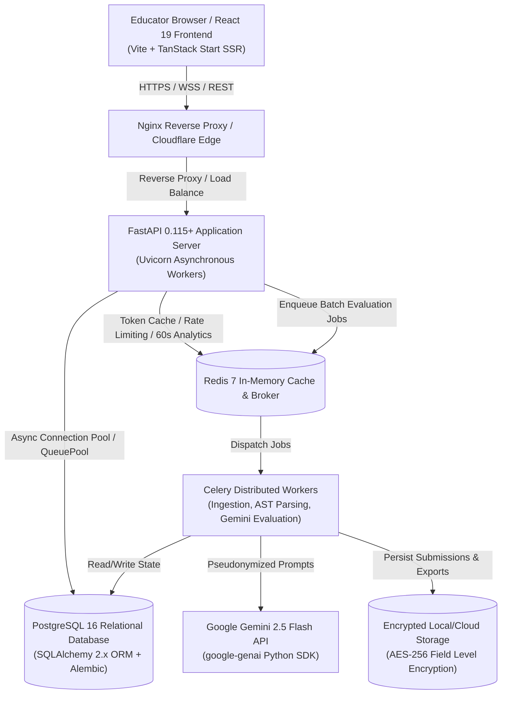
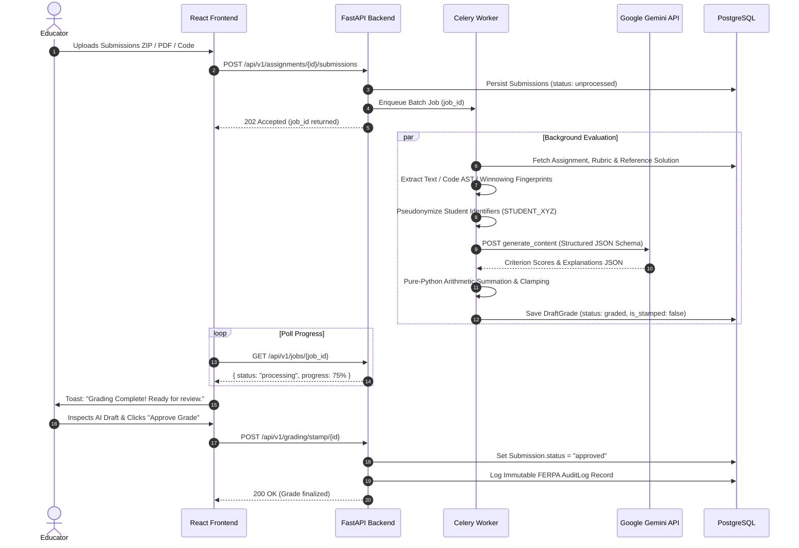

# System Architecture & Technical Design

## 1. High-Level Architecture Overview

Verism AI is architected as a high-throughput, asynchronous, multi-tenant SaaS application designed to process thousands of student submissions concurrently while maintaining strict data isolation, cryptographic privacy, and sub-second UI responsiveness.

---

## 2. Core Service Topology

### 2.1 Web & Application Layer
- **Framework:** FastAPI on Python 3.11+.
- **ASGI Server:** Uvicorn with asynchronous event loops (`asyncio` / `anyio`).
- **Connection Resilience:** SQLAlchemy `QueuePool` with:
  - `pool_pre_ping=True`: Test-on-borrow socket health check (`SELECT 1`).
  - `pool_recycle=1800`: 30-minute idle connection recycling to survive cloud firewall drops.
  - TCP Keep-Alives: `keepalives=1`, `keepalives_idle=30`, `keepalives_interval=10`, `keepalives_count=5`.
  - Resilience Decorator: `@with_db_retry(max_retries=3, backoff_base=0.5)` catching transient disconnects.
- **Enterprise Security Middleware:** Automatically injects:
  - `X-Content-Type-Options: nosniff`
  - `X-Frame-Options: DENY`
  - `X-XSS-Protection: 1; mode=block`
  - `Strict-Transport-Security: max-age=31536000; includeSubDomains`
  - `Referrer-Policy: strict-origin-when-cross-origin`

### 2.2 Asynchronous Background Workers
- **Queue Broker:** Redis 7 with database slot 0 for Celery, slot 1 for 60s analytics caching, slot 2 for session token invalidation.
- **Worker Execution:** Celery 5.4+ with concurrency workers and prefetch multipliers tuned for I/O bound Gemini network calls.
- **Task Types:**
  - `process_submission_file`: Multi-format parsing (PDF, DOCX, ZIP, Code AST).
  - `evaluate_submission_batch`: Asynchronous grading orchestration with Gemini 2.5 Flash.
  - `run_pairwise_winnowing`: Cross-submission AST and n-gram similarity comparison.
  - `generate_bulk_gradebook_export`: Offline generation of comprehensive Excel workbooks and audit archives.

### 2.3 Client-Side Architecture
- **Framework:** React 19 + TypeScript.
- **Build System:** Vite 8 + TanStack Start (SSR + Nitro Cloudflare compatibility).
- **Navigation & Routing:** `@tanstack/react-router` with type-safe file routes.
- **State & Remote Synchronization:** `@tanstack/react-query` with optimistic cache updates and debounced mutation refetches.
- **Data Visualizations:** Recharts 2.15 for SVG-native interactive histograms, longitudinal trend lines, and skill-gap heatmaps.

---

## 3. Asynchronous Evaluation Workflow

