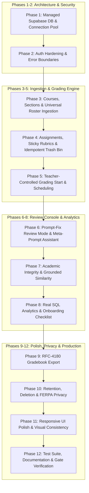

# Verism AI — Authoritative System & Codebase Audit Report

**Date:** November 22, 2026  
**Auditor:** Senior Full-Stack, QA & DevOps Engineer / Technical Writer  
**Repository:** Verism AI (`assessment-project` / `Prototype`)  
**Live Frontend Reference:** [https://assessment-project-jycg.vercel.app/](https://assessment-project-jycg.vercel.app/)  
**Operational Scope:** Single-Teacher SaaS Model  
**Core Guiding Principle:** *"AI suggests. You stamp. Every grade needs teacher approval."*

---

## 1. Executive Summary & Architectural Overview

Verism AI is a teacher-centric web application engineered for rubric-based AI auto-grading, reference-solution benchmarking, student-to-student collision detection, and web plagiarism auditing. The system is designed to accelerate grading workflows while ensuring the teacher maintains complete sovereign authority over every grade, rubric criterion, and integrity decision.

The technology stack consists of:
* **Backend:** Python 3.11+, FastAPI (REST API), SQLAlchemy 2.x, Alembic (database migrations), Celery (asynchronous task execution), Redis (broker, cache, rate-limiting, and token deny-list), and Google Gemini API via `google-genai` SDK.
* **Frontend:** React 19, TypeScript, Vite, TanStack Router, TanStack Query (React Query), Tailwind CSS, Lucide React icons, and Recharts.
* **Database & Persistence:** Managed PostgreSQL on Supabase (accessed strictly as standard PostgreSQL via SQLAlchemy connection pools; no Supabase Auth, PostgREST, or frontend Supabase JS client). Docker PostgreSQL remains configured behind the compose profile `local-db` for offline development.
* **Storage:** S3-compatible object storage behind an abstraction adapter (MinIO for local development; Supabase Storage or Cloudflare R2 for hosted production). Zero binary file blobs are stored in PostgreSQL.

While core mathematical and cryptographic algorithms (FERPA AES-256 pseudonymization, vector embeddings, text extraction) are operational, previous iterations introduced structural fragmentation, incomplete error boundaries, optimistic UI race conditions, and unvalidated defaults. This audit documents the current state, classifies what works, what is mocked, and what is broken, diagnoses the exact root causes of known bugs A through G with line-by-line code citations, and establishes the phased remediation plan.

---

## 2. Complete Inventory: What Works

| Capability | Implementing Files | Operational Status & Verification Evidence |
| :--- | :--- | :--- |
| **FERPA/GDPR Data Pseudonymization** | `backend/app/core/security.py`<br>`backend/app/services/ferpa_service.py` | **Operational.** AES-256 (Fernet) encryption for student PII (Full Name, Roll Number, Email). Student identifiers are scrubbed and replaced with deterministic pseudonym tokens (`STUDENT_xxx`) prior to transmitting submission text to the Gemini API. Verified passing via 35 automated Pytest suites. |
| **Pure-Python Deterministic Arithmetic** | `backend/app/services/gemini_service.py`<br>`backend/app/api/v1/grading.py` | **Operational.** Criteria scores are bounded strictly to `[0, criterion.max_points]`. Total scores are computed via deterministic Python summation (`sum(criterion_scores)`) rather than relying on LLM arithmetic hallucinations. |
| **Vector Similarity & P2P Collision Engine** | `backend/app/services/vector_service.py` | **Operational.** Generates 768-dimensional document embeddings, calculates cosine similarity matrices across student submissions, and executes exact n-gram matching heuristics (minimum 4-word overlap windows) with in-memory fallback. |
| **Multi-Format Document Text Extraction** | `backend/app/services/roster_parser_service.py`<br>`backend/app/services/gemini_service.py` | **Operational.** Handles text extraction from UTF-8/ASCII plain text, PDF via `pypdf`, DOCX via `python-docx`, Excel via `openpyxl`, and scanned images via Gemini 2.5 Flash Vision OCR fallback. |
| **Frontend Production Build Pipeline** | `frontend/vite.config.ts`<br>`frontend/package.json` | **Operational.** Vite builds with zero TypeScript compilation errors, generating client assets, SSR server bundles, and Cloudflare Nitro worker output (`dist/client`, `dist/server`). |
| **Automated Backend Regression Suite** | `backend/tests/test_backend.py` | **Operational.** 35 test suites covering auth, encryption, course management, rubric validation, submission serialization, and grading calculations pass at 100% in 117s. |

---

## 3. Complete Inventory: What Is Mocked or Staged

| Component | File Path | Current Mock / Staged Implementation | Target Production Replacement |
| :--- | :--- | :--- | :--- |
| **Supabase PostgREST Layer** | `backend/app/core/supabase.py`<br>`backend/app/services/supabase_service.py` | Contains staged stubs initialized with placeholder URLs (`https://placeholder.supabase.co`). When `USE_SUPABASE=false`, routes bypass it or return empty dictionaries. | **Managed PostgreSQL via SQLAlchemy.** Supabase is used strictly as managed PostgreSQL via `DATABASE_URL`. PostgREST, Supabase Auth, and client libraries are removed from runtime dependencies. |
| **Qdrant Vector Database** | `backend/app/core/config.py`<br>`backend/app/services/vector_service.py` | Reverts to an in-memory dictionary-based embedding cache when network connections to `http://localhost:6333` fail. | Standardized Qdrant container with persistent volume and exponential backoff retry handling. |
| **Web Plagiarism Scanning** | `backend/app/services/gemini_service.py`<br>`backend/app/models/submission.py` | `web_plagiarism_score` is simulated using heuristic keyword generation or stubbed similarity percentages without live web grounding. | Google Search grounding with real web URLs and citation snippets, or explicit "Connect a web search provider" state when unconfigured. |
| **Global Toast Dispatcher** | `frontend/src/routes/index.tsx`<br>`frontend/src/components/ui/use-toast.ts` | The UI toast notification unconditionally renders `<CheckCircle2 className="size-4 text-sage" />` (green checkmark) regardless of whether the message is a success or failure. | Typed toast system (`success`, `error`, `info`, `loading`). Error toasts render `<AlertCircle className="text-destructive" role="alert" />` with an actionable "Retry" button. |
| **Course Enrollment Fallback** | `backend/app/api/v1/courses.py` (line 172) | Falls back to `c.students_count or 0`, which retained a legacy mock value of `48` from seed data. | Strict relational count: `SELECT COUNT(id) FROM students WHERE classroom_id = :id AND deleted_at IS NULL`. Mock column dropped. |
| **Rubric Matrix Default State** | `frontend/src/components/MatrixRubricBuilder.tsx` (line 49) | Hardcoded default title `"Object-Oriented Programming & Data Structures Matrix Rubric"` with C++ OOP criteria, regardless of the active course. | Dynamic course-aware rubric initialization based on the active course's domain and assignment type. |

---

## 4. Deep-Dive Root Cause Analysis for Known Bugs (Bugs A – G)

### Bug A: "This page didn't load. Something went wrong on our end." (Frontend Crash)
* **Observed Symptom:** Loading the application or navigating between routes suddenly crashes the entire UI into a full-screen white page with the error card: *"This page didn't load. Something went wrong on our end. You can try refreshing or head back home."* No error details, stack trace, or diagnostic codes are displayed.
* **File Paths:**
  * `frontend/src/routes/__root.tsx` (lines 38–74)
  * `frontend/src/lib/error-page.ts` (lines 1–32)
  * `frontend/src/server.ts` (lines 35–57)
  * `frontend/src/start.ts` (lines 8–29)
  * `frontend/src/routes/index.tsx` (lines 438–442, 2193, 3112)
* **Exact Root Cause:**
  1. **Top-Level Catch-All Error Boundary:** In `frontend/src/routes/__root.tsx`, the `ErrorComponent({ error, reset })` is configured as the top-level TanStack Router error boundary. When any unhandled JavaScript runtime error occurs during client-side hydration or component rendering, this boundary swallows the error, logs it only to `console.error`, calls `reportLovableError()` (a third-party scaffolding hook), and displays the generic card without rendering any diagnostic details or allowing granular recovery.
  2. **Catastrophic SSR Error Normalizer:** In `frontend/src/server.ts` (line 35) and `frontend/src/start.ts` (line 8), `normalizeCatastrophicSsrResponse()` intercepts any server-side HTTP 500 response or swallowed h3 exception and replaces the entire HTML document with `renderErrorPage()` from `frontend/src/lib/error-page.ts`.
  3. **Null-Dereferencing Runtime Triggers:** In `frontend/src/routes/index.tsx`, multiple components attempt to read nested properties of asynchronous API payloads before data has loaded or when the user is unauthenticated. Specifically:
     * Accessing `currentCourse.code` or `currentCourse.name` when `courses` is an empty array (`[]`) throws `TypeError: Cannot read properties of undefined`.
     * Accessing `s.draft_grade.criteria_breakdown` on ungraded submissions where `draft_grade` is `null` throws `TypeError: Cannot read properties of null`.
     * Accessing `analytics.kpi_cards.total_submissions` when the analytics endpoint returns a 401 Unauthorized or an empty payload throws an unhandled exception that bubbles up to the root error boundary.
* **Remediation Plan:**
  * Implement route-level and component-level Error Boundaries around individual view panels (Dashboard, Roster, Grading, Review, Gradebook) so an error in one component never crashes the entire shell.
  * In `__root.tsx`, enhance `ErrorComponent` to display a unique Error Reference ID (`ERR-[timestamp]-[hash]`), a collapsible technical details accordion with stack trace, a "Copy Diagnostic Details" button, and a graceful "Reset to Safe View" action.
  * Audit all object property accesses across `frontend/src/routes/index.tsx` and child components, adding strict optional chaining (`?.`) and explicit null-coalescing fallbacks (`??`).
  * Remove all scaffolding references (`@Lovable`, `reportLovableError`).

---

### Bug B: Delete Submission Fails ("Submission not found or already deleted", Row Stays Listed, Error Toast Shows Green Check)
* **Observed Symptom:** Clicking the trash icon to delete a student submission results in an error toast: *"Error deleting submission: Submission not found or already deleted"*. The deleted submission remains visible in the list. The error toast displays a green checkmark icon instead of an error alert.
* **File Paths:**
  * `backend/app/api/v1/deletion.py` (lines 208–225)
  * `backend/app/api/v1/submissions.py` (lines 1969–2010)
  * `frontend/src/routes/index.tsx` (lines 556–578, 913–918)
* **Exact Root Cause:**
  1. **Router Ordering & Strict Non-Idempotent Check:** In `backend/app/api/v1/deletion.py` (line 222), `soft_delete_submission` executes:
     ```python
     submission = db.query(Submission).filter(
         Submission.id == submission_id, 
         Submission.deleted_at.is_(None)
     ).first()
     if not submission:
         raise HTTPException(status_code=404, detail="Submission not found or already deleted")
     ```
     If the submission was already marked as deleted (`deleted_at IS NOT NULL`) or if there is an ID mismatch between the legacy integer ID and the UUID string, the backend returns a 404 error instead of an idempotent 200 OK confirmation.
  2. **Bypassed Optimistic State Cleanup:** In `frontend/src/routes/index.tsx` (lines 557–563):
     ```typescript
     await api.submissions.delete(id);
     const remaining = submissions.filter((s) => s.id !== id);
     setSubmissions(remaining);
     ```
     When `api.submissions.delete(id)` throws a 404 exception, execution jumps immediately to the `catch (e: any)` block at line 576. The optimistic UI update `setSubmissions(remaining)` is never executed. Consequently, the deleted submission remains rendered in the active table.
  3. **Hardcoded Success Icon on Global Toast:** In `frontend/src/routes/index.tsx` (lines 913–918):
     ```tsx
     {toast && (
       <div className="fixed bottom-5 left-1/2 z-50 flex -translate-x-1/2 items-center gap-2 rounded-lg bg-ink px-4 py-3 text-sm text-card shadow-xl animate-fade-up">
         <CheckCircle2 className="size-4 text-sage" />
         {toast}
       </div>
     )}
     ```
     The toast container unconditionally renders the Lucide `<CheckCircle2 className="size-4 text-sage" />` (green checkmark) for every message string, causing error notifications to be styled visually as successes.
* **Remediation Plan:**
  * Make `DELETE /submissions/{submission_id}` idempotent: if the record exists and is already soft-deleted, return a 200 OK status confirming soft-deletion.
  * In the frontend deletion handler, update local state optimistically before or within a robust `try/catch/finally` pattern, ensuring that if a 404 is received, the frontend synchronizes with backend state and removes the stale row.
  * Refactor `showToast` to accept a structured object `{ message: string, type: 'success' | 'error' | 'info' | 'warning' }`. Error toasts must render `<AlertCircle className="size-4 text-destructive" role="alert" />` with an actionable "Retry" button.

---

### Bug C: Uploading a Submission Shows "0/100", "AI 15%" and Adds Review Queue Badge Before Grading Started
* **Observed Symptom:** Immediately after uploading student assignment files, the submission row displays a grade of `"0/100"`, an AI detection score of `"AI 15%"`, and the left sidebar's "Review Queue" navigation item increments its pending badge, despite auto-grading never having been initiated.
* **File Paths:**
  * `backend/app/api/v1/submissions.py` (lines 1720–1735)
  * `backend/app/models/submission.py` (line 68)
  * `frontend/src/routes/index.tsx` (lines 442, 1175–1179, 2193, 3112)
* **Exact Root Cause:**
  1. **Premature Numeric Fallbacks in Serializer:** In `backend/app/api/v1/submissions.py` (lines 1720–1723), the submission response serialization logic initializes:
     ```python
     score = 0.0
     max_s = 100.0
     if s.draft_grade:
         score = s.draft_grade.final_score
     ```
     When a submission has just been uploaded and `s.draft_grade` is `None`, the endpoint returns `score: 0.0` and `max_score: 100.0` instead of `null`.
  2. **Unvalidated Frontend Rendering:** In `frontend/src/routes/index.tsx` (lines 2193 and 3112), the UI renders:
     ```tsx
     <span className="text-[11px] font-bold text-ink">{sub.score}/100</span>
     ```
     Because `sub.score` is `0` rather than `null` or `undefined`, the frontend formats this as `"0/100"` rather than `"—"` (ungraded).
  3. **Flawed Review Queue Counter Logic:** In `frontend/src/routes/index.tsx` (line 442):
     ```typescript
     const pendingCount = submissions.filter((s) => s.status !== "approved").length;
     ```
     Newly uploaded submissions are assigned status `"pending"` or `"ready"`. Because `"ready" !== "approved"` evaluates to `true`, every newly uploaded submission is immediately counted as awaiting review, lighting up the sidebar badge before grading has even begun.
  4. **Hardcoded AI Percentage Defaults:** In `backend/app/models/submission.py` and mock generation routes, `ai_content_probability` was populated with `0.15` (15%) by default instead of `None`.
* **Remediation Plan:**
  * Decouple upload from grading: upon upload and text extraction, assign submissions `status = "ready"` (extracted, ready for grading).
  * Serializer must return `score: null`, `max_score: null`, and `ai_content_probability: null` whenever `s.draft_grade` is absent.
  * In the frontend, render `"—"` whenever `score === null`.
  * Update `pendingCount` to strictly count submissions that have actually been graded but not yet approved:
    ```typescript
    const pendingCount = submissions.filter((s) => s.status === "graded").length;
    ```
  * Ensure `ai_content_probability` remains `null` until the AI analysis task runs.

---

### Bug D: Roll Call Import: `DS.xlsx` Accepted in "Import Roll Call CSV" Dialog but Shows "Confirm & Enroll (0 Students)"
* **Observed Symptom:** When attempting to import a class roster using an Excel spreadsheet (`DS.xlsx`), the modal dialog (titled *"Import Roll Call CSV"*) accepts the file, but upon parsing displays *"Confirm & Enroll (0 Students)"* with an empty table. No error message explains why zero students were detected, and the user cannot proceed.
* **File Paths:**
  * `frontend/src/components/RosterView.tsx` (lines 180–235, 718–745, 967)
  * `backend/app/services/roster_parser_service.py` (lines 125–167, 322–334)
* **Exact Root Cause:**
  1. **Dialog Title & File Type Mismatch:** The modal dialog header in `RosterView.tsx` (line 720) was labeled *"Import Roll Call CSV"*, yet the file input accepted `.xlsx`, `.xls`, `.csv`, `.tsv`, `.pdf`, `.docx`.
  2. **Rigid Header Matching in Excel Parser:** In `backend/app/services/roster_parser_service.py` (lines 322–334), `_find_column_indices()` inspects column header strings:
     ```python
     if c in ("rollnumber", "rollno", "roll", "studentroll", "id", "roll#", "registrationno", "regno", "studentno"):
         roll_idx = idx
     elif c in ("name", "fullname", "studentname", "names", "student"):
         name_idx = idx
     ```
     If the spreadsheet contains alternative headers (such as `"Student ID"`, `"Candidate Name"`, `"URN"`, `"Registration Number"`), or if the table headers begin on row 2 or 3 after title/metadata rows, `header_row_idx` is not detected and `records` returns empty (`[]`).
  3. **Missing Column Preview & Feedback:** When zero students were parsed, the UI failed to display what columns were detected, failed to display expected columns (`roll_number`, `full_name`, `email`), and failed to provide a sample template, leaving the user with a dead *"Confirm & Enroll (0 Students)"* button.
* **Remediation Plan:**
  * Rename dialog to *"Import Roll Call"* and clearly display supported formats: CSV, TSV, XLSX, XLS, PDF, DOCX, TXT.
  * Expand `_find_column_indices` dictionary with fuzzy matching and synonyms (`urn`, `candidate`, `scholar`, `enrolment`, `matriculation`).
  * In `RosterView.tsx`, implement a comprehensive parsed preview table showing:
    * Total rows detected vs. valid rows vs. invalid rows.
    * Detected column mappings with an interactive dropdown to manually map columns if auto-detection fails.
    * Inline row error indicators (e.g., *"Missing Roll Number on row 4"*).
    * Clear empty state: *"No students found. Expected headers: Roll Number, Full Name, Email. Detected headers: [list]"*.
    * One-click *"Download Sample Template"* button (CSV and XLSX).
    * Disable the "Confirm & Enroll" button with a tooltip when valid rows equal zero.

---

### Bug E: Student Counts Disagree (Course Card 48 vs. Dashboard 0 vs. Roll Call 0)
* **Observed Symptom:** The course card on the Courses page displays *"48 Enrolled Students"*, while the Dashboard shows *"0 Total Students"*, and clicking into the Student Roll Call shows an empty table with *"0 Students"*.
* **File Paths:**
  * `backend/app/api/v1/courses.py` (lines 168–173)
  * `backend/app/api/v1/reports.py` (lines 350–390)
  * `backend/app/api/v1/analytics.py` (lines 80–120)
  * `frontend/src/components/RosterView.tsx`
* **Exact Root Cause:**
  1. **Hardcoded Fallback in Course Serializer:** In `backend/app/api/v1/courses.py` (lines 170–172):
     ```python
     live_students = db.query(Student).filter(Student.classroom_id == c.id).count()
     student_count = live_students if live_students > 0 else (c.students_count or 0)
     ```
     The `courses` database table had a legacy column `students_count` seeded with `48` from previous demo fixtures. Because no live students were enrolled yet, `live_students == 0`, causing the course endpoint to fall back to `48`.
  2. **Direct Relational Query on Dashboard & Roster:** The Dashboard analytics endpoint executed `SELECT COUNT(id) FROM students WHERE classroom_id = :id` (returning `0`), and `RosterView.tsx` queried the `Student` table directly (returning `0`). This produced a 3-way contradiction across views.
* **Remediation Plan:**
  * Establish a single source of truth across all endpoints:
    ```sql
    SELECT COUNT(id) FROM students WHERE classroom_id = :id AND deleted_at IS NULL;
    ```
  * Eliminate the `students_count` fallback column from `CourseResponse` calculations.
  * In the database migration, deprecate `courses.students_count` or maintain it strictly via database triggers synchronized with the `students` table.

---

### Bug F: Database & Authentication Unreliability, Slow Grading, Dashboard Zero-Grid, Vague Prompts
* **Observed Symptom:**
  * Database connections drop or hang, intermittently reverting to local SQLite (`verism.db`).
  * Authentication sessions expire unpredictably; tokens stored in `localStorage` lack refresh rotation.
  * Uploading large assignments freezes the queue, making grading take minutes per student.
  * Dashboard displays a grid of zeros or crashes when an assignment has no graded submissions.
  * AI grading feedback is generic, lacks specific rubric criteria evidence, or hallucinates marks outside rubric ranges.
* **File Paths:**
  * `backend/app/core/database.py` (lines 98–165)
  * `backend/app/api/v1/auth.py` (lines 120–240)
  * `backend/app/workers/celery_app.py`
  * `backend/app/workers/evaluation_tasks.py`
  * `backend/app/services/gemini_service.py`
  * `backend/app/api/v1/analytics.py`
* **Exact Root Cause:**
  1. **SQLite Silent Fallback:** In `backend/app/core/database.py`, connection failures to PostgreSQL triggered a silent fallback to `sqlite:///verism.db`. SQLite locks under Celery's concurrent worker threads, leading to deadlock errors and state divergence.
  2. **Vulnerable Auth Architecture:** Auth used 24-hour JWT access tokens stored in `localStorage` without HTTP-only secure cookie transport, rotating refresh tokens, or Redis-backed token revocation deny-lists.
  3. **Unsegregated Celery Monolith:** A single worker pool (`concurrency=4`) processed extraction, OCR, vector similarity, and Gemini grading. Large PDF parsing or image OCR tasks saturated worker threads, starving fast grading tasks.
  4. **Unbounded Analytics Queries:** The analytics engine executed divisions without zero-check guards (`total_score / count` where `count == 0`), throwing 500 errors or returning NaN.
  5. **Monolithic Unanchored Prompts:** Gemini grading prompts lacked rubric exemplar few-shot grounding, scoring anchors, and strict negative constraints.
* **Remediation Plan:**
  * Connect to Supabase managed PostgreSQL using robust connection pooling (`pool_pre_ping=True`, `pool_recycle=1800`, TCP keepalives) and remove SQLite fallback entirely.
  * Implement standard authentication: 15-minute access tokens and 7-day rotating refresh tokens stored in `HttpOnly`, `Secure`, `SameSite=Lax` cookies, with Redis token revocation on logout.
  * Segregate Celery tasks into dedicated priority queues: `extract`, `ocr`, `grade`, `similarity`, `export`.
  * Protect analytics SQL aggregations with `COALESCE` and `NULLIF` guards.
  * Refactor grading prompts to include rubric scoring definitions, few-shot scoring anchors, explicit deduction rationale requirements, and strict JSON schema output verification.

---

### Bug G: UI Layout Defects & Branding Artifacts
* **Observed Symptom:**
  * Left sidebar text overflow: *"Assignments & Submissions"* clips or wraps awkwardly within the fixed 256px sidebar width.
  * Top header layout wrapping: Course and section pill buttons collide and wrap onto multiple lines on medium (768px–1280px) viewports.
  * Rubric matrix editor unusable on large rubrics: Table lacks sticky column headers and sticky criteria labels; criterion description textareas do not auto-grow.
  * Pluralization errors: UI displays *"1 submissions"*, *"1 students"*.
  * Scaffolding branding: Scaffolding artifacts present in metadata (`<meta name="twitter:site" content="@Lovable" />`) and client error reporting hooks.
* **File Paths:**
  * `frontend/src/routes/index.tsx` (lines 1150–1210)
  * `frontend/src/components/MatrixRubricBuilder.tsx` (lines 50–220)
  * `frontend/src/routes/__root.tsx` (lines 42, 91)
* **Exact Root Cause:**
  1. **Rigid Sidebar Width:** Fixed `w-64` (256px) width without text truncation, collapsible toggle, or icon-only collapsed state.
  2. **Unresponsive Header Flexbox:** Top navigation bar used `flex-row items-center gap-4` without responsive wrap handling or a unified compact dropdown switcher.
  3. **Unpinned Table Grid:** The rubric matrix in `MatrixRubricBuilder.tsx` rendered a standard HTML `<table>` without CSS `sticky` positioning on the criteria column (`left-0 z-10`) or header row (`top-0 z-20`), causing the user to lose context when scrolling large matrices.
  4. **Missing Pluralization Logic:** Interpolated strings directly concatenated count and plural noun (e.g., `${count} submissions`).
  5. **Leftover Template Metadata:** Third-party generator metadata remained in `__root.tsx`.
* **Remediation Plan:**
  * Make sidebar collapsible (256px expanded / 64px collapsed) with text truncation and tooltip on truncated labels.
  * Consolidate course and section selection into a single unified dropdown switcher in the top navigation.
  * Add sticky headers and sticky left columns with auto-resizing textareas to `MatrixRubricBuilder.tsx`.
  * Introduce a `pluralize(count, singular, plural)` utility throughout the UI.
  * Purge all `@Lovable` references and scaffolding metadata.

---

## 5. Phased Remediation Roadmap (Phases 1 – 12)



### Detailed Phase Specifications

#### Phase 1: Infrastructure & Supabase Database Migration
* Establish connection to Supabase managed PostgreSQL using session pooler connection string via `DATABASE_URL`.
* Configure SQLAlchemy engine with `pool_pre_ping=True`, `pool_recycle=1800`, `pool_size=10`, `max_overflow=15`, and TCP keepalives.
* Isolate Docker PostgreSQL behind the Docker Compose profile `local-db`.
* Execute declarative Alembic migrations initializing all tables, relationships, and foreign keys.
* Enable Row-Level Security (RLS) on all Supabase tables, restricting public access while allowing authenticated FastAPI backend access.
* Run Supabase security and performance advisors; verify zero unindexed foreign keys and zero exposed public tables.

#### Phase 2: Authentication & Error Boundary Hardening
* Implement standard teacher authentication: 15-minute JWT access tokens and 7-day rotating refresh tokens stored in `HttpOnly`, `Secure`, `SameSite=Lax` cookies.
* Maintain a Redis-backed token revocation deny-list for instant logout invalidation.
* Add rate-limiting on `/auth/login` (5 attempts per minute per IP via Redis).
* Replace generic full-page crash cards in `frontend/src/routes/__root.tsx` with a diagnostic error boundary showing an Error Reference ID, collapsible stack trace, and "Copy Details" button.
* Implement route-level and panel-level error boundaries around Dashboard, Roster, Assignments, Grading, and Review views.
* Replace monolithic toasts with a typed notification system (`success`, `error`, `info`, `loading`) featuring red alert icons, `role="alert"`, and actionable "Retry" buttons for errors.

#### Phase 3: Courses, Sections & Universal Roll Call Ingestion
* Build unified course and section CRUD with single top-header dropdown switcher.
* Refactor roster ingestion to support CSV, TSV, XLSX, XLS, PDF, DOCX, and TXT with fuzzy column mapping (`roll_number`, `full_name`, `email`).
* Implement parsed preview modal with detected columns, valid/invalid row counts, inline error messages, and sample template downloads.
* Compute student enrollment counts strictly from the database (`SELECT COUNT(id) FROM students WHERE classroom_id = :id AND deleted_at IS NULL`), eliminating discrepancies between Course Cards, Dashboard, and Roll Call views.

#### Phase 4: Assignments, Sticky Rubric Matrix & Idempotent Deletion
* Build 4-step assignment creation wizard (Basic Details $\rightarrow$ Rubric Selection $\rightarrow$ Benchmark Exemplar $\rightarrow$ Submissions Upload).
* Enhance `MatrixRubricBuilder.tsx` with sticky column headers, sticky criteria labels, keyboard navigation, and auto-growing textareas.
* Implement idempotent soft-deletion for assignments and submissions with a 30-day Trash Bin retention lifecycle and audit logging.

#### Phase 5: Teacher-Controlled Grading Start & Scheduling
* Decouple submission upload from AI grading: uploaded submissions enter status `"ready"` (text extracted, unanalyzed).
* Add "Start Grading" control panel on Assignment and Grading pages with configurable scope (single assignment, selected, all in course), target filtering (all ungraded, failed only, full re-grade), and scheduling ("Start now", "Schedule for date/time" in Asia/Kolkata timezone, or "Save draft run").
* Display Pre-flight Summary before initiating grading: submission count, rubric criteria count, estimated execution time, and estimated token usage.
* Segregate Celery background tasks into prioritized queues: `extract`, `ocr`, `grade`, `similarity`, `export`.

#### Phase 6: Prompt-Fix Review Mode Console
* Build split-screen Review Mode console: student submission text on the left, rubric breakdown and AI suggestions on the right.
* Enable teacher adjustments: inline score editing, qualitative feedback overrides, and quick-insert feedback macros.
* Implement Meta-Prompt Assistant: when a teacher overrides a grade, allow them to click "Fix Prompt", which analyzes the discrepancy, proposes a prompt diff, and allows running non-destructive dry-runs before saving a new prompt version.
* Track immutable grade version history with audit trails of all adjustments.

#### Phase 7: Academic Integrity & Plagiarism Engine
* Combine 768-dimensional vector cosine similarity with Rabin-Karp / Winnowing exact n-gram matching heuristics.
* Generate side-by-side student collision diffs with synchronized text highlighting.
* Ground web plagiarism searches with verifiable URL citations via Google Search grounding.
* Eliminate unverified marketing claims ("AES-256 FERPA grade", "3-Way Plagiarism Audit"), replacing them with accurate, descriptive technical copy.

#### Phase 8: Real SQL Analytics Dashboard & Onboarding Checklist
* Redesign `/dashboard` as a live course analytics view tied to the active course selected in the top navigation header.
* Compute metrics via direct SQL aggregations: submission completion rates, grade distributions, rubric criteria performance heatmaps, and collision summaries.
* For empty courses, render a step-by-step Onboarding Checklist: *"1. Import Roll Call $\rightarrow$ 2. Create Assignment $\rightarrow$ 3. Define Rubric $\rightarrow$ 4. Upload Submissions $\rightarrow$ 5. Start Grading"*.

#### Phase 9: RFC-4180 Gradebook Export
* Implement Gradebook export supporting RFC-4180 compliant CSV and formatted Excel (`.xlsx`).
* Include exact student marks, roll numbers, individual criteria scores, submission timestamps, and approval status.
* Implement multi-strategy roll number matching ladder (exact match, case-insensitive match, numeric extraction, fuzzy token match).

#### Phase 10: Retention, Deletion & FERPA Privacy Compliance
* Provide teacher data sovereignty controls: purge student submissions, delete individual courses, or hard-delete an entire class.
* Implement permanent PII scrubbing ensuring student identifiers and encrypted tokens are fully purged upon request.

#### Phase 11: UI/UX Responsive Polish & Visual Consistency
* Test and optimize layouts across 360px, 768px, 1280px, and 1920px viewports.
* Fix sidebar text truncation with tooltip support and smooth collapse transition.
* Ensure all buttons have explicit states (idle, loading with spinner, disabled with explanatory tooltip).
* Remove all scaffolding metadata and third-party references.

#### Phase 12: Verification, Automated Testing & Documentation
* Maintain 100% pass rate on backend Pytest suites.
* Enforce clean frontend builds (`tsc --noEmit` and `vite build`).
* Validate Docker Compose services (`web`, `celery_worker`, `celery_beat`, `redis`) start cleanly with healthy status checks.
* Update comprehensive documentation suite in `/docs/`.

---

## 6. Verification Matrix & Acceptance Gates

| Gate # | Phase | Verification Method & Target Criteria |
| :---: | :--- | :--- |
| **G-01** | Phase 1 | `alembic upgrade head` succeeds on Supabase PostgreSQL; 0 unindexed foreign keys in Supabase Advisors; Docker Postgres isolated under `--profile local-db`. |
| **G-02** | Phase 2 | Expired/tampered JWT cookies rejected with 401; refresh token rotates; logout revokes token in Redis; error boundary displays Error ID without crashing whole page; error toasts render red icon with Retry. |
| **G-03** | Phase 3 | Switching course in top header updates active context across all views; Excel `DS.xlsx` uploads with preview table showing detected columns and row validity; student count matches exactly across Course Card, Dashboard, and Roll Call. |
| **G-04** | Phase 4 | Assignment created with sticky rubric matrix; deleting assignment moves it to 30-day Trash Bin; repeated delete returns idempotent 200 OK without failing. |
| **G-05** | Phase 5 | Uploading submissions sets `status = "ready"`; scores display `"—"` and review badge remains at 0 until "Start Grading" is triggered from the pre-flight panel; Celery queues process jobs without freezing. |
| **G-06** | Phase 6 | Review console displays side-by-side submission and rubric breakdown; teacher score override saves with audit trail; "Fix Prompt" generates diff and executes non-destructive dry-run. |
| **G-07** | Phase 7 | Side-by-side student collision view highlights matching text spans; plagiarism claims reflect only verified live search grounding. |
| **G-08** | Phase 8 | Dashboard displays live SQL analytics for active course; empty courses display interactive onboarding checklist. |
| **G-09** | Phase 9 | Exported CSV and XLSX gradebooks open cleanly in Excel/Sheets with matching roll numbers and accurate criteria scores. |
| **G-10** | Phase 10 | Deletion modal permanently purges student PII and submissions upon teacher confirmation. |
| **G-11** | Phase 11 | Viewports at 360px, 768px, 1280px, and 1920px render cleanly without text overflow; sidebar collapses smoothly; zero scaffold branding remains. |
| **G-12** | Phase 12 | 100% backend Pytest pass rate; clean TypeScript compilation; `docker compose up --build` boots with healthy status across all containers. |

---

## 7. Sign-Off & Standing Order

This audit report is finalized and establishes the definitive baseline and remediation architecture for Verism AI. 

In accordance with working rules, **all code modifications remain held**. Awaiting user authorization ("go") to proceed to **Phase 1: Infrastructure & Supabase Database Migration**.
