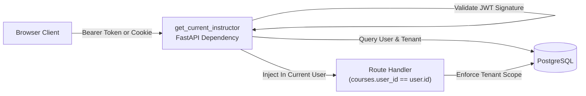

# Authentication, Multi-Tenancy & Cryptographic Security

## 1. Multi-Tenant Identity Model

Verism AI enforces strict tenant isolation at the database, service, and API layers. Every instructor account belongs to an isolated security context, ensuring educators can never inspect, grade, or export another instructor's course data.



---

## 2. Token Lifecycle & Rotation

### 2.1 Access Tokens (Short-Lived)
- **Algorithm:** HMAC-SHA256 (`HS256`).
- **Lifespan:** 15 minutes.
- **Payload Schema:**
  ```json
  {
    "sub": "inst_priya_rao",
    "email": "priya.rao@university.edu",
    "role": "instructor",
    "exp": 1732230000,
    "iat": 1732229100,
    "type": "access"
  }
  ```

### 2.2 Refresh Tokens & Invalidation
- **Lifespan:** 7 days.
- **Rotation:** Whenever `/api/v1/auth/refresh` is called, the old refresh token is blacklisted in Redis and a new token pair is issued.
- **Logout & Revocation:** `POST /api/v1/auth/logout` explicitly writes the token jti into Redis with an expiration matching the token's remaining TTL. Any subsequent request with a blacklisted token immediately yields `401 Unauthorized`.

---

## 3. Cookie Security & CSRF Defense

When browser clients authenticate via `POST /api/v1/auth/login`, access and refresh tokens are stored in secure cookies:
- `HttpOnly`: Inaccessible via client-side JavaScript (`document.cookie`), immunizing the platform from Cross-Site Scripting (XSS) token theft.
- `Secure`: Transmitted strictly over encrypted TLS connections (HTTPS).
- `SameSite=Lax`: Defends against Cross-Site Request Forgery (CSRF) on cross-origin requests.

---

## 4. FERPA Field-Level Encryption & LLM Pseudonymization

Under the **Family Educational Rights and Privacy Act (FERPA)** (34 CFR Part 99):
1. **At-Rest Encryption:** Student names, emails, and identifiers stored in the database undergo field-level AES-256 Fernet symmetric encryption.
2. **LLM In-Flight Pseudonymization:** Before any submission is dispatched to the Google Gemini API for auto-grading, student identifying attributes are extracted and replaced with deterministic pseudonyms:
   ```text
   Raw Student Text: "Alice Smith (Roll: S101) - Lab 1 Implementation"
   Pseudonymized LLM Prompt: "STUDENT_A3F89B - Lab 1 Implementation"
   ```
   The real name is never sent to the LLM. Once Gemini returns the evaluation JSON, Verism re-maps `STUDENT_A3F89B` back to Alice Smith on the server.
