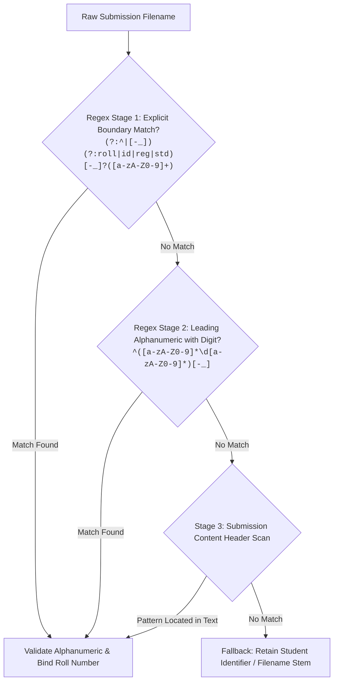

# Gradebook Export & Spreadsheets Integration Guide

> **Core Philosophy:** *"AI suggests. You stamp. Every grade waits for your approval."*  
> **Module Version:** 2.4.0  
> **Implementation Reference:** `backend/app/services/export_service.py` & `backend/app/api/v1/gradebook.py`

---

## 1. Overview & RFC-4180 Compliance

Verism AI provides institutional-grade gradebook exports in both **RFC-4180 compliant CSV** and **Openpyxl-styled XLSX** formats. Gradebooks can be exported in two distinct evaluation states:
1. **Draft Mode (`mode=draft`):** Exports AI-suggested marks, feedback notes, and unconfirmed criteria scores for pre-grading moderation.
2. **Final Approved Mode (`mode=final`):** Exports strictly approved and stamped grades. Submissions still awaiting teacher approval are marked as `"PENDING APPROVAL"` with blank or deferred numerical totals to prevent premature grade release.

### RFC-4180 Adherence & Excel UTF-8 BOM
Standard CSV files often render with corrupted special characters (e.g., student names with accents, diacritics, or non-Latin glyphs) when opened in Microsoft Excel on Windows. Verism AI prefixes all exported CSV byte-streams with the **UTF-8 Byte Order Mark (BOM: `\ufeff`)**:
- Guarantees seamless, native Unicode decoding across Microsoft Excel, Google Sheets, Apple Numbers, and LibreOffice Calc.
- All text fields containing commas (`,`), quotation marks (`"`), or newlines (`\n`) are strictly escaped with double-quote delimiters per RFC-4180 §2.7.

---

## 2. Formula Injection Defense (CWE-1236)

CSV Command Injection (also known as Formula Injection) occurs when untrusted user input (such as student names, submitted filenames, roll numbers, or teacher feedback strings) begins with spreadsheet execution triggers:
- Equals sign: `=`
- Plus sign: `+`
- Minus sign: `-`
- At symbol: `@`
- Tab character: `\t`
- Carriage return: `\r`

When an educator opens an unescaped CSV, spreadsheet applications can execute arbitrary DDE (Dynamic Data Exchange) macros or exfiltrate private institutional tokens via outbound HTTP links.

### Sanitization Implementation
Verism AI routes every exported string through `sanitize_for_csv()` in `backend/app/services/export_service.py`:
```python
def sanitize_for_csv(value: Any) -> str:
    """
    Sanitize cell content to prevent CSV/formula injection (CWE-1236).
    Prefixes values starting with '=', '+', '-', '@', '\t', or '\r' with a single quote.
    """
    if value is None:
        return ""
    text = str(value)
    if text and text[0] in ("=", "+", "-", "@", "\t", "\r"):
        return f"'{text}"
    return text
```
- A student named `=cmd|'/C calc'!A0` or a feedback note beginning with `@SUM(...)` is neutralized into `'=cmd|'/C calc'!A0`.
- The single quote is hidden visually in modern spreadsheet applications while completely disabling formula execution.

---

## 3. Supported Layout Formats & Schema Dictionary

Verism AI supports three layout formats selectable via `?format=default|google_classroom|moodle`:

### 3.1. Default Layout (`format=default`)
The authoritative institutional gradebook schema detailing granular rubric breakdown:
| Column Header | Data Type | Description |
| :--- | :--- | :--- |
| `Student Name` | String | Full name of the student from enrolled course roster. |
| `Roll Number` | String | Extracted or enrolled unique student roll number / registration ID. |
| `Email` | String | Student institutional email address. |
| `Assignment Name` | String | Name of the assignment being reported. |
| `Total Score` | Float | Final score (exact pure-Python sum of approved criteria). |
| `Max Score` | Float | Maximum achievable points configured in assignment rubric. |
| `Percentage` | String | Computed percentage with 2-decimal formatting (e.g., `87.50%`). |
| `Status` | String | `APPROVED`, `PENDING APPROVAL`, or `MISSING`. |
| `Graded At` | ISO-8601 | UTC timestamp when the instructor approved the grade. |
| `Feedback Summary` | String | High-level synthesis of student strengths and improvement areas. |
| `Criterion: <Name>` | Float / Str | One column per rubric criterion detailing points earned. |

### 3.2. Google Classroom Layout (`format=google_classroom`)
Matches the official Google Classroom Gradebook CSV import specification:
```csv
Student Name,Email Address,Grade,Max Grade,Comments
"Smith, Alice",alice.smith@university.edu,85.00,100.00,"Excellent analysis of distributed consensus."
"Jones, Bob",bob.jones@university.edu,72.00,100.00,"Missing proof for Paxos safety invariants."
```

### 3.3. Moodle Offline Grading Worksheet (`format=moodle`)
Matches Moodle's native offline grading sheet schema for direct round-trip upload:
```csv
Identifier,Full name,Email address,Status,Grade,Maximum Grade,Feedback comments
"std-001","Alice Smith",alice.smith@university.edu,"Graded",85.00,100.00,"Strong execution."
"std-002","Bob Jones",bob.jones@university.edu,"Graded",72.00,100.00,"Review Paxos quorum logic."
```

---

## 4. Prioritized Roll Number Extraction Waterfall Ladder

Student submissions often arrive in bulk ZIP archives with varied naming conventions. Verism AI implements a multi-stage regex waterfall ladder to automatically bind submissions to enrolled student roll numbers:



### Regex Stage Details
1. **Explicit Tag Match:** Detects tokens like `roll-101`, `id_cs2024`, `reg0984`.
2. **Digit-Enforced Prefix:** Matches prefixes like `21BCS104_assignment1.pdf` while strictly rejecting purely alphabetic words like `unidentified_homework.txt` to prevent false positives.
3. **Document Text Inspection:** Scans the first 500 characters of parsed PDFs/DOCXs for strings matching `Roll No:\s*([A-Za-z0-9_-]+)`.

---

## 5. Pure-Python Deterministic Arithmetic Engine

To eliminate LLM hallucination and floating-point cumulative rounding errors, the grading engine never asks Gemini to sum scores. Instead:
1. The AI is restricted to scoring individual rubric sub-criteria.
2. The backend aggregates total scores using pure-Python IEEE-754 arithmetic:
   ```python
   # Pure-Python deterministic marks aggregation
   total_score = round(sum(float(c.get("score", 0.0)) for c in criteria_breakdown), 2)
   percentage = round((total_score / max_score) * 100.0, 2) if max_score > 0 else 0.0
   ```
3. The exported gradebook matches the criterion columns with 100% mathematical consistency.

---

## 6. Styled Openpyxl XLSX Generation & SHA-256 Non-Repudiation

When requested with `.xlsx`, `generate_xlsx_bytes()` constructs a styled Microsoft Excel workbook:
- **Header Styling:** Deep Navy (`#1E293B`) fill, pure white bold text, centered vertical alignment.
- **Zebra Striping:** Alternating light slate rows (`#F8FAFC` vs. `#FFFFFF`) for readability.
- **Dynamic Auto-Fit Columns:** Automatically computes maximum string widths with padding to eliminate truncated cells.
- **Cryptographic Audit Trail:** Every generated export stream has its SHA-256 digest computed and recorded in the `Export` database table:
  ```python
  sha256_hash = hashlib.sha256(content_bytes).hexdigest()
  ```
  This provides non-repudiation and proof of academic record integrity for accreditation bodies.
