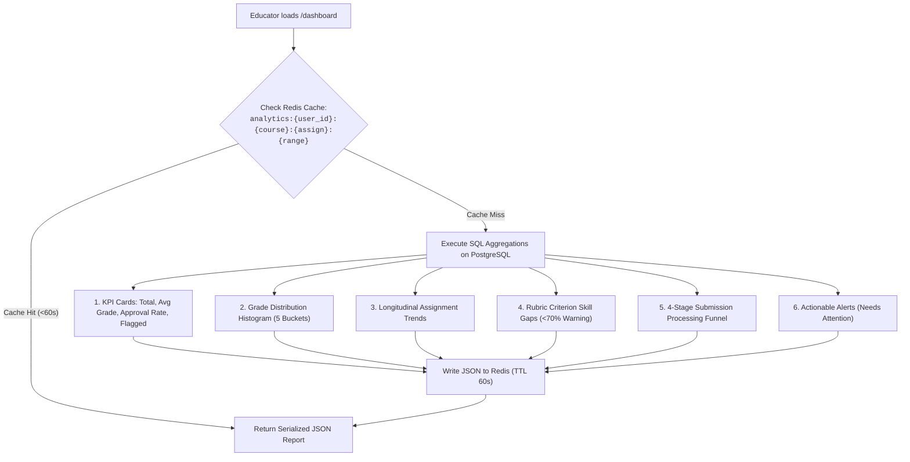

# Real-Time Course Analytics & Reporting Engine

> **Core Philosophy:** *"AI suggests. You stamp. Every grade waits for your approval."*  
> **Module Version:** 2.4.0  
> **Implementation Reference:** `backend/app/api/v1/reports.py` & `frontend/src/routes/index.tsx`

---

## 1. Overview & Architectural Guarantees

The Verism AI Course Analytics Dashboard provides real-time, actionable pedagogical intelligence derived strictly from live relational database records:
1. **Zero Mock Data:** Every figure, chart bucket, and progress percentage is computed directly from PostgreSQL tables (`submissions`, `draft_grades`, `rubric_criteria`, `similarity_matches`).
2. **60-Second In-Memory Redis Cache:** Database query load is minimized using Redis-backed caching with automatic invalidation upon grade approvals or new submissions.
3. **Course & Section Dynamic Binding:** Selecting a course or section in the top header dynamically refilters all analytical widgets across the entire view.
4. **One-Click Actionable Alerts:** Identifies low-performing students and plagiarism collisions, providing instant navigation deep-links to remediate issues.

---

## 2. Analytical Metrics & SQL Aggregation Pipeline



### 2.1. Key Performance Indicator (KPI) Cards
The top metrics row summarizes four fundamental classroom health indicators:
- **Total Submissions:** Count of all uploaded student papers within the selected course and timeframe.
- **Average Grade (%):** Pure-Python weighted average of approved grades (`DraftGrade.is_approved == True`).
- **Approval Rate (%):** Proportion of AI-graded submissions that have been reviewed and stamped by the teacher:
  $$\text{Approval Rate} = \frac{\text{Count}(\text{Approved Grades})}{\text{Count}(\text{Total Graded Submissions})} \times 100$$
- **Plagiarism Flagged (%):** Proportion of submissions flagged with similarity collisions $\ge 30\%$ or high internal code duplication.

### 2.2. Grade Distribution Histogram (5 Standard Academic Buckets)
Submissions are categorized into five standard pedagogical tiers:
- `< 60%` (Failing / Remedial)
- `60% – 69%` (Needs Improvement)
- `70% – 79%` (Competent / Satisfactory)
- `80% – 89%` (Proficient / High Quality)
- `90% – 100%` (Mastery / Exemplary)

### 2.3. Longitudinal Assignment Trends
Tracks class progress across successive assignments:
- Plots Average Score, Highest Score, and Lowest Score chronologically.
- Highlights whether class comprehension is improving or regressing as curriculum complexity advances.

### 2.4. Criterion Skill Gaps Heatmap
Aggregates student scores broken down by individual rubric criteria:
- Compares mean student performance against the maximum points allocated per criterion.
- Criteria scoring **below 70%** are highlighted in warm clay/amber as urgent class-wide skill deficiencies, notifying instructors to review the topic during the next lecture.

### 2.5. Four-Stage Submission Processing Funnel
Visualizes assignment lifecycle progression:
1. **Ingested:** Uploaded, parsed, and OCR-extracted.
2. **Evaluated:** Evaluated by Gemini 2.5 Flash against the rubric.
3. **Pending Review:** Draft grades waiting in the instructor's queue.
4. **Approved & Stamped:** Confirmed grades recorded in the Gradebook.

---

## 3. High-Performance Redis Caching & Invalidation Strategy

### Cache Key Structure
```
analytics:{user_id}:{course_id}:{assignment_id}:{date_range}
```
- **TTL:** 60 seconds.
- **Graceful Degradation:** If Redis is offline or unreachable, the system automatically falls back to direct database execution with zero user disruption.

### Cache Invalidation Triggers
The Redis analytics cache is immediately evicted whenever:
1. An instructor clicks "Approve Grade" or performs bulk approval in the Review Queue.
2. A new batch of student submissions finishes ingestion.
3. An assignment or course is modified or soft-deleted.

---

## 4. Sandbox Demo-Data Lifecycle

For product demonstrations, sandbox trials, and instructor onboarding, Verism AI includes an idempotent demo data generation and teardown suite:

### 4.1. Load Demo Data (`POST /api/v1/analytics/demo-data`)
Seeds a complete, realistic course environment:
- **Course:** `CS101 • Introduction to Distributed Systems` (Cohort A).
- **Enrolled Roster:** 12 diverse student records with unique roll numbers (`CS24B001` through `CS24B012`).
- **Assignment:** `Project 1: Raft Consensus Implementation` (100 Max Points).
- **Rubric:** 4 weighted criteria (*Leader Election*, *Log Replication*, *Safety Invariants*, *Code Style*).
- **Submissions & Grades:**
  - 8 Approved grades with realistic score spreads and multi-paragraph feedback.
  - 3 Pending Review draft grades awaiting teacher stamp.
  - 1 Flagged submission with a high-similarity collision match.

### 4.2. Clear Demo Data (`DELETE /api/v1/analytics/demo-data`)
Performs a surgical purge of all demo-tagged records across courses, assignments, submissions, and student rosters, leaving real educator production data completely untouched.
