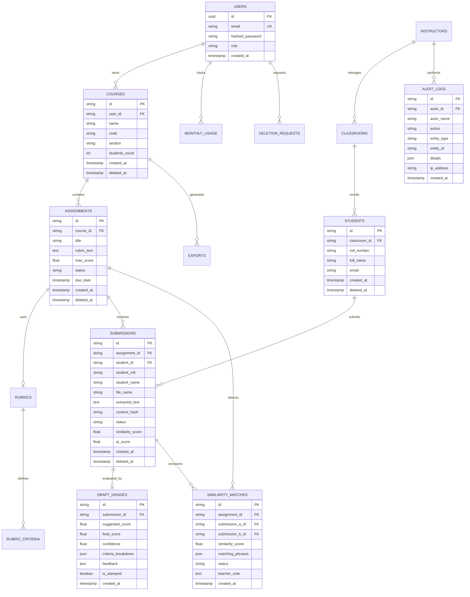

# Database Schema & Relational Specifications

## 1. Relational Entity-Relationship Diagram (ERD)



---

## 2. Table Dictionaries & Schema Definitions

### 2.1 `courses` Table
Central organizational entity grouping assignments, rubrics, and students.
- `id` (`VARCHAR(64)`): Primary key alphanumeric identifier.
- `user_id` (`VARCHAR(64)`): Foreign key referencing `users.id` with `ON DELETE SET NULL`.
- `name` (`VARCHAR(255)`): Human-readable title (e.g., *"Distributed Systems"*).
- `code` (`VARCHAR(64)`): Academic course catalog code (e.g., *"CS-401"*). Indexed for fast filtering.
- `section` (`VARCHAR(32)`): Cohort section letter (default *"A"*).
- `tone` (`VARCHAR(32)`): UI color theme key (`lav`, `blue`, `sage`, `amber`).
- `students_count` (`INTEGER`): Denormalized enrolled count for rapid dashboard rendering.
- `deleted_at` (`TIMESTAMP NULL`): Soft-deletion timestamp. When set, excludes record from active queries while retaining it in the 30-day trash bin.

### 2.2 `assignments` Table
Evaluated task specifications and rubric bindings.
- `id` (`VARCHAR(64)`): Primary key.
- `course_id` (`VARCHAR(64)`): Foreign key to `courses.id` with `ON DELETE CASCADE`. Indexed.
- `title` (`VARCHAR(255)`): Assignment name (e.g., *"Lab 1: Concurrency"*).
- `description` (`TEXT NULL`): Detailed task instructions.
- `max_score` (`FLOAT`): Total maximum points attainable (default `100.0`).
- `starter_code` (`TEXT NULL`): Canonical boilerplate or template code automatically subtracted during winnowing.
- `reference_solution` (`TEXT NULL`): Ground truth exemplar used to benchmark student correctness.
- `due_date` (`TIMESTAMP NULL`): Submission deadline used for on-time vs late metrics.
- `deleted_at` (`TIMESTAMP NULL`): Soft-deletion timestamp.

### 2.3 `submissions` Table
Individual student work items uploaded as PDF, DOCX, ZIP, or code.
- `id` (`VARCHAR(64)`): Primary key.
- `assignment_id` (`VARCHAR(64)`): Foreign key to `assignments.id` with `ON DELETE CASCADE`. Indexed.
- `student_id` (`VARCHAR(64) NULL`): Foreign key to `students.id`.
- `student_roll` (`VARCHAR(64)`): Extracted academic roll number (e.g., *"S102"*).
- `student_name` (`VARCHAR(255)`): Full student name.
- `content_hash` (`VARCHAR(64)`): SHA-256 hash of extracted text/code used to short-circuit redundant Gemini API calls.
- `status` (`VARCHAR(32)`): Processing state: `unprocessed`, `processing`, `graded`, `approved`, `flagged`.
- `similarity_score` (`FLOAT`): Peak pairwise winnowing overlap (0.0 to 100.0).
- `ai_score` (`FLOAT`): Synthetic text likelihood indicator (0.0 to 100.0).
- `deleted_at` (`TIMESTAMP NULL`): Soft-deletion timestamp.

### 2.4 `draft_grades` Table
AI evaluation suggestions and finalized marks.
- `id` (`VARCHAR(64)`): Primary key.
- `submission_id` (`VARCHAR(64)`): Unique foreign key to `submissions.id` (`ON DELETE CASCADE`).
- `suggested_score` (`FLOAT`): Exact pure-Python sum of individual rubric criteria.
- `final_score` (`FLOAT NULL`): Teacher-stamped final mark. `NULL` while pending.
- `confidence` (`FLOAT`): Model evaluation confidence estimate (0.0 to 1.0).
- `criteria_breakdown` (`JSON`): Structured array containing `{ criterion_name, score, max_points, explanation }`.
- `feedback` (`TEXT`): Actionable strengths and improvement suggestions for the student.
- `is_stamped` (`BOOLEAN`): `True` when approved by educator; `False` while recommendation draft.

### 2.5 `similarity_matches` Table
Pairwise academic integrity collisions detected via AST winnowing.
- `id` (`VARCHAR(64)`): Primary key.
- `assignment_id` (`VARCHAR(64)`): Foreign key to `assignments.id` (`ON DELETE CASCADE`). Indexed.
- `submission_a_id` (`VARCHAR(64)`): First submission in comparison pair.
- `submission_b_id` (`VARCHAR(64)`): Second submission in comparison pair.
- `similarity_score` (`FLOAT`): Overlap percentage (e.g. `94.5`).
- `matching_phrases` (`JSON`): List of exact or near-identical text phrases or AST token sequences.
- `status` (`VARCHAR(64)`): Qualitative label (`"High similarity"`, `"Within range"`, `"Dismissed"`).
- `teacher_note` (`TEXT NULL`): Optional educator investigation notes.

---

## 3. Database Resilience & Indexing Strategy

### 3.1 Composite Indexes
To ensure sub-10ms query execution across millions of rows, the following indexes are maintained:
```sql
CREATE INDEX idx_courses_user_deleted ON courses(user_id, deleted_at);
CREATE INDEX idx_assignments_course_deleted ON assignments(course_id, deleted_at);
CREATE INDEX idx_submissions_assign_status ON submissions(assignment_id, status, deleted_at);
CREATE INDEX idx_students_classroom_roll ON students(classroom_id, roll_number);
CREATE INDEX idx_similarity_assign_score ON similarity_matches(assignment_id, similarity_score DESC);
CREATE INDEX idx_audit_created ON audit_logs(created_at DESC);
```

### 3.2 Automated Column Migration & Schema Healing
The application includes automatic startup DDL migrations via `ensure_schema_columns()` in `app/core/database.py`. It inspects live catalog columns and dynamically applies missing `ALTER TABLE` statements for:
- `deleted_at` on `courses`, `assignments`, `submissions`, `students`, `rubrics`
- `confidence` on `draft_grades`
- `criteria_breakdown`, `feedback`, `plagiarism_report` on historical tables
