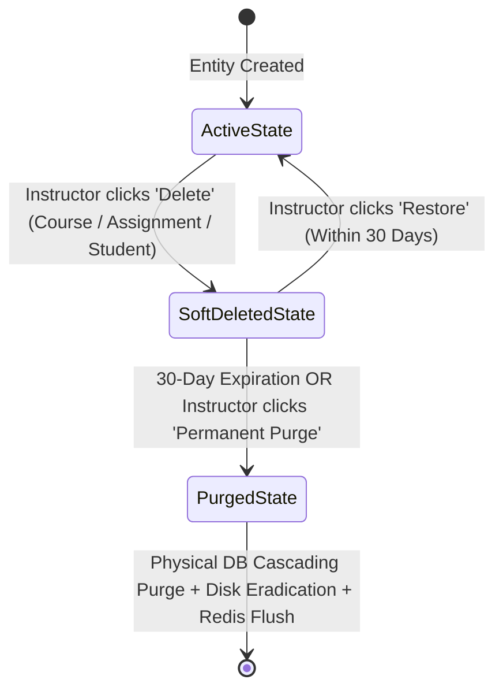

# Privacy, Data Deletion & Institutional Compliance Guide

> **Core Philosophy:** *"AI suggests. You stamp. Every grade waits for your approval."*  
> **Module Version:** 2.4.0  
> **Implementation Reference:** `backend/app/api/v1/deletion.py`, `backend/app/core/security.py`, `backend/app/main.py`

---

## 1. Overview & Regulatory Framework

Verism AI is engineered to comply with strict global privacy standards and higher-education data governance regulations, including:
- **FERPA (Family Educational Rights and Privacy Act):** Complete cryptographic protection of student educational records and strict teacher-scoped multi-tenant data access.
- **GDPR (General Data Protection Regulation):** Full compliance with Article 17 ("Right to Erasure") and Article 20 ("Right to Data Portability").
- **DPDP Act (Digital Personal Data Protection Act):** Full adherence to Section 12 for prompt personal data withdrawal, grievance redressal, and institutional record purging.
- **COPPA Compliance:** Direct educator consent model with zero telemetry or behavioral profiling on student work.

---

## 2. 30-Day Soft-Deletion & Trash Bin Lifecycle

Accidental deletion of academic records can disrupt semester grading and accreditation audits. Verism AI implements a two-stage deletion protocol:



### 2.1. Soft-Delete Semantics (`deleted_at`)
- When a user deletes a Course or Assignment, the record is NOT destroyed.
- A UTC timestamp is written to `deleted_at`:
  ```python
  entity.deleted_at = datetime.utcnow()
  db.commit()
  ```
- Normal application queries across the Dashboard, Review Queue, and Gradebook filter with `filter(Entity.deleted_at.is_(None))`.

### 2.2. The 30-Day Trash Bin API
Soft-deleted entities are retained in an isolated quarantine zone accessible via `/api/v1/trash`:

| Method | Endpoint | Description |
| :--- | :--- | :--- |
| `GET` | `/api/v1/trash` | Lists all soft-deleted courses, assignments, and students, including `days_remaining` until automated physical purging. |
| `POST` | `/api/v1/trash/restore/{entity_type}/{id}` | Instantly restores the entity and its children back to active production state (`deleted_at = None`). |
| `DELETE` | `/api/v1/trash/permanent/{entity_type}/{id}` | Bypasses the 30-day retention buffer and executes an irreversible physical cascade purge. |

---

## 3. Irreversible Cascade Purge Architecture

When a permanent purge is triggered:
1. **Relational Database Purge:** The parent record and all child entities (`Submissions`, `DraftGrades`, `SimilarityMatches`, `Exports`, `AuditLogs`) are physically dropped via SQLAlchemy cascading foreign keys.
2. **Local & Object Storage Erasure:** All extracted text files, uploaded student PDFs, DOCX files, code archives, and generated gradebook spreadsheets on disk (`uploads/` and `exports/`) are securely unlinked.
3. **In-Memory Cache Invalidation:** Redis keys matching `analytics:*`, `gradebook:*`, and submission status caches are evicted.
4. **Audit Log Recording:** A permanent entry is inscribed into `audit_logs` detailing the timestamp, actor ID, and purged entity ID.

---

## 4. GDPR Article 20 / DPDP Data Portability ZIP Archive

Educators have the statutory right to export their entire portfolio at any moment without vendor lock-in.

### The `/api/v1/user/export-all-data` Endpoint
Generates an in-memory, password-safe `.zip` bundle containing structured JSON representations of the educator's full institutional workspace:

```
verism_data_export_user_<ID>_<TIMESTAMP>.zip
├── profile.json             # Educator account details, institution, and security preferences
├── courses.json             # Course catalog, sections, codes, and enrolled student rosters
├── assignments.json         # Assignments, guidelines, reference solutions, and weighted rubrics
├── submissions.json         # Raw extracted text, file paths, upload metadata, and token usage
├── grades.json              # Approved grades, draft grades, criterion scores, and written feedback
├── similarity_matches.json  # Internal cross-submission collusion matches and AST comparison reports
└── audit_logs.json          # Complete tamper-evident chronological event log
```

- Streamed over HTTP with `Content-Type: application/zip`.
- Downloadable directly from the Settings page via a one-click action.

---

## 5. Right to Erasure & Legal Contract Endpoints

### 5.1. Erasure Request (`POST /api/v1/privacy/erasure-request`)
Enables educators or institutions to submit a formal account termination and physical data eradication ticket:
- Validates the user's password to prevent session hijacking attacks.
- Places the account in scheduled purge mode.
- Returns a tracking ticket ID and estimated completion timestamp.

### 5.2. Legal & Privacy Policies
Verism AI serves live institutional legal documentation directly from versioned backend markdown assets:
- `GET /api/v1/legal/privacy`: Complete privacy policy specifying zero data selling, FERPA student confidentiality, and LLM isolation guarantees.
- `GET /api/v1/legal/terms`: Master terms of service for universities, schools, and independent educators.
- `GET /api/v1/legal/dpa`: Standard Data Processing Addendum (DPA) incorporating European Standard Contractual Clauses (SCCs).

---

## 6. HTTP Security Headers Middleware

Implemented via `SecurityHeadersMiddleware` in `backend/app/main.py` across all HTTP responses:

```http
Strict-Transport-Security: max-age=31536000; includeSubDomains; preload
X-Content-Type-Options: nosniff
X-Frame-Options: DENY
X-XSS-Protection: 1; mode=block
Referrer-Policy: strict-origin-when-cross-origin
Permissions-Policy: camera=(), microphone=(), geolocation=(), payment=()
Content-Security-Policy: default-src 'self'; script-src 'self' 'unsafe-inline'; style-src 'self' 'unsafe-inline'; img-src 'self' data: https:; font-src 'self' data:; connect-src 'self' https:;
```
- **HSTS:** Enforces HTTPS for all client connections for a minimum of 1 year.
- **Clickjacking Prevention:** `X-Frame-Options: DENY` ensures Verism AI cannot be embedded inside malicious third-party IFrames.
- **MIME Sniffing Block:** `X-Content-Type-Options: nosniff` forces browsers to honor declared content types.
