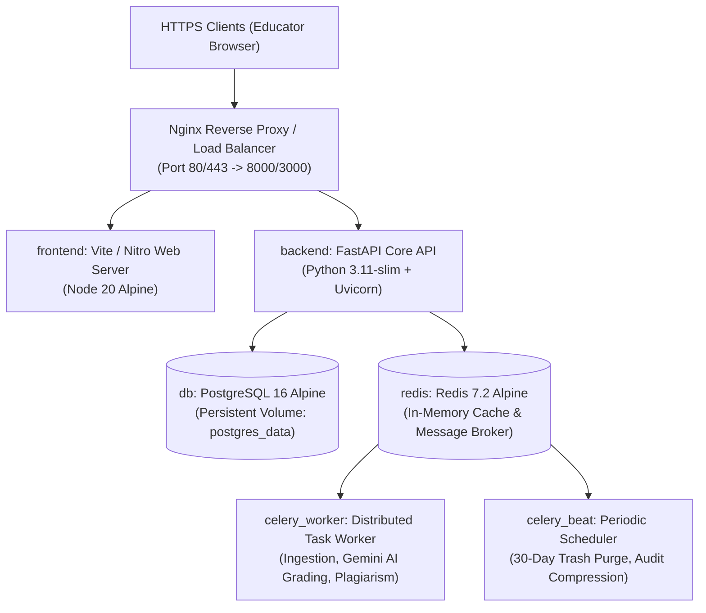

# Deployment & Infrastructure Runbook

> **Core Philosophy:** *"AI suggests. You stamp. Every grade waits for your approval."*  
> **Module Version:** 2.4.0  
> **Target Environments:** Docker Compose (Local/On-Prem), Google Cloud Run, Render, AWS ECS

---

## 1. Container Architecture & Microservices Topology

Verism AI is containerized into a robust, decoupled multi-service architecture:



---

## 2. Docker Compose Production Configuration

The multi-container stack is orchestrated via `docker-compose.yml`:

```yaml
version: '3.8'

services:
  # 1. PostgreSQL Database
  db:
    image: postgres:16-alpine
    container_name: verism_postgres
    restart: always
    environment:
      POSTGRES_USER: ${POSTGRES_USER:-verism_admin}
      POSTGRES_PASSWORD: ${POSTGRES_PASSWORD:-secure_pg_pass_2026}
      POSTGRES_DB: ${POSTGRES_DB:-verism_db}
    volumes:
      - postgres_data:/var/lib/postgresql/data
    healthcheck:
      test: ["CMD-SHELL", "pg_isready -U ${POSTGRES_USER:-verism_admin} -d ${POSTGRES_DB:-verism_db}"]
      interval: 5s
      timeout: 5s
      retries: 5
    networks:
      - verism_net

  # 2. Redis Message Broker & Cache
  redis:
    image: redis:7-alpine
    container_name: verism_redis
    restart: always
    command: redis-server --appendonly yes --requirepass ${REDIS_PASSWORD:-secure_redis_pass_2026}
    volumes:
      - redis_data:/data
    healthcheck:
      test: ["CMD", "redis-cli", "-a", "${REDIS_PASSWORD:-secure_redis_pass_2026}", "ping"]
      interval: 5s
      timeout: 5s
      retries: 5
    networks:
      - verism_net

  # 3. FastAPI Core Backend
  backend:
    build:
      context: ./backend
      dockerfile: Dockerfile
    container_name: verism_backend
    restart: always
    depends_on:
      db:
        condition: service_healthy
      redis:
        condition: service_healthy
    env_file:
      - .env
    volumes:
      - uploads_data:/app/uploads
      - exports_data:/app/exports
    ports:
      - "8000:8000"
    networks:
      - verism_net

  # 4. Celery Async Worker
  celery_worker:
    build:
      context: ./backend
      dockerfile: Dockerfile
    container_name: verism_celery_worker
    restart: always
    command: celery -A app.core.celery_app worker --loglevel=info --concurrency=4
    depends_on:
      db:
        condition: service_healthy
      redis:
        condition: service_healthy
    env_file:
      - .env
    volumes:
      - uploads_data:/app/uploads
      - exports_data:/app/exports
    networks:
      - verism_net

  # 5. Frontend Single Page Application
  frontend:
    build:
      context: ./frontend
      dockerfile: Dockerfile
    container_name: verism_frontend
    restart: always
    ports:
      - "3000:3000"
    networks:
      - verism_net

volumes:
  postgres_data:
  redis_data:
  uploads_data:
  exports_data:

networks:
  verism_net:
    driver: bridge
```

---

## 3. Environment Variables Configuration Dictionary (`.env`)

Maintain all sensitive configuration in `.env` (never commit `.env` to git):

| Variable Name | Required | Default Example | Description |
| :--- | :--- | :--- | :--- |
| `DATABASE_URL` | **Yes** | `postgresql://user:pass@db:5432/verism_db` | PostgreSQL connection string with async/sync driver. |
| `REDIS_URL` | **Yes** | `redis://:pass@redis:6379/0` | Redis broker and cache connection string. |
| `GEMINI_API_KEY` | **Yes** | `AIzaSy...` | Google GenAI API Key for Gemini 2.5 Flash evaluation. |
| `JWT_SECRET_KEY` | **Yes** | `e837f4...64_hex_chars...` | Cryptographic secret for signing auth tokens. |
| `JWT_ALGORITHM` | No | `HS256` | Token signing algorithm. |
| `ACCESS_TOKEN_EXPIRE_MINUTES` | No | `60` | Lifetime of access token before refresh required. |
| `ENCRYPTION_KEY` | **Yes** | `Fernet_Key_32_Bytes=` | AES-256 Fernet key for encrypting student PII at rest. |
| `ALLOWED_ORIGINS` | No | `http://localhost:3000,https://verism.edu` | Comma-separated CORS origins allowed by FastAPI. |
| `ENVIRONMENT` | No | `production` | Runtime mode (`development`, `staging`, `production`). |

---

## 4. Multi-Stage Dockerfiles

### 4.1. Backend Dockerfile (`backend/Dockerfile`)
- Base image: `python:3.11-slim`.
- Uses multi-stage wheel builds to keep production images lightweight (~180MB).
- Runs under non-privileged dedicated user `verism` (UID 10001).
- Includes curl healthcheck probing `/health`.

### 4.2. Frontend Dockerfile (`frontend/Dockerfile`)
- Stage 1: `node:20-alpine` builds the Vite production bundles (`npm run build`).
- Stage 2: `nginx:alpine` or Node server serves optimized static assets with gzip/brotli compression and browser cache-control headers.

---

## 5. Cloud Deployment Guides

### 5.1. Google Cloud Run + Cloud SQL
1. Provision a Cloud SQL PostgreSQL instance and Memorystore Redis instance on GCP.
2. Build and push container images to Google Artifact Registry:
   ```bash
   gcloud builds submit --tag gcr.io/$PROJECT_ID/verism-backend:latest ./backend
   ```
3. Deploy Backend to Cloud Run with Cloud SQL connector enabled and environment secrets injected from Google Secret Manager.
4. Deploy Frontend to Cloud Run or Firebase Hosting.

### 5.2. Render / Railway Deployment
- Deploy via the included `render.yaml` or repository connection.
- Attach managed PostgreSQL and Redis add-ons.
- Set root directories to `backend` and `frontend` respectively.
