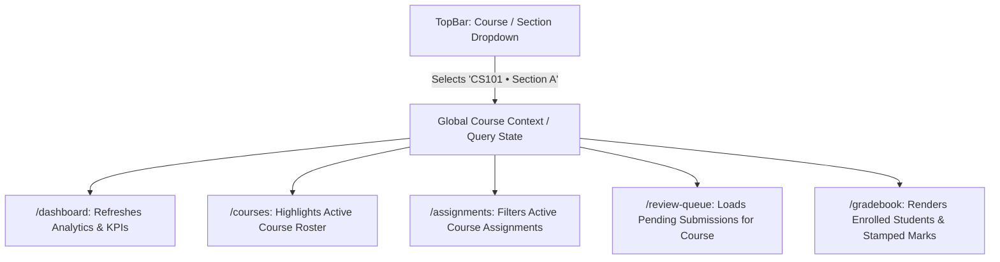

# Frontend Architecture & Client-Side Design System

> **Core Philosophy:** *"AI suggests. You stamp. Every grade waits for your approval."*  
> **Module Version:** 2.4.0  
> **Implementation Reference:** `frontend/src/` (Vite, React 19, TypeScript, TanStack Router & Query, Tailwind CSS v4, Recharts)

---

## 1. Overview & Frontend Technology Stack

The Verism AI user interface is built as a high-performance, accessible, and reactive Single Page Application (SPA) with server-side generation capabilities:
- **Framework:** React 19 + TypeScript (strict mode enabled).
- **Build Tool:** Vite 5 with HMR and optimized chunk splitting.
- **Routing:** TanStack Router (fully type-safe routes with query parameter validation).
- **Data Fetching & State:** TanStack Query v5 (automatic background refetching, optimistic updates, and garbage-collected cache).
- **Styling:** Tailwind CSS v4 design tokens with custom academic elevation levels and high-contrast accessibility.
- **Charts & Visualizations:** Recharts with responsive SVG containers and theme-aware styling.
- **Icons:** Lucide React icons.

---

## 2. Directory Structure & Modular Layout

```
frontend/src/
├── app.tsx                 # Root application wrapper with QueryClientProvider and RouterProvider
├── entry-client.tsx        # Client-side hydration entry point
├── entry-server.tsx        # SSR / Nitro build entry point
├── index.css               # Tailwind CSS v4 core imports, design variables, and font bindings
├── lib/
│   ├── api.ts              # Centralized type-safe API client (Axios/Fetch with JWT interceptors)
│   └── utils.ts            # ClassName merging (clsx + tailwind-merge) and formatting helpers
├── components/
│   ├── ui/                 # Atomic design components (Button, Card, Modal, Dropdown, Badge, Toast)
│   ├── TopBar.tsx          # Sticky global navigation bar with Course & Section switcher and search
│   ├── Sidebar.tsx         # Left navigation bar (Dashboard, My Courses, Review Queue, Gradebook, Settings)
│   └── charts/             # Recharts wrapper components (Histogram, Trends, SkillGaps, Funnel)
└── routes/
    ├── index.tsx           # Authoritative application views (Dashboard, Courses, Assignments, Submissions, Settings)
    └── __root.tsx          # Root layout scaffolding holding Sidebar, TopBar, and Main View Outlet
```

---

## 3. Global Context & Course-Section Synchronization

The educator's active course and section context are managed globally to ensure synchronized analytical views:



### State Synchronization Guarantee
- Selecting a course updates the reactive TanStack Query key: `['analytics', courseId, sectionId]`.
- All dependent widgets, tables, and metric cards automatically refetch and animate new data without full-page reloads.

---

## 4. Design System & Visual Philosophy

Verism AI utilizes a purpose-built design system tailored for academic rigor and long grading sessions:

### 4.1. Color Palette
- **Deep Navy (`#0F172A` / `#1E293B`):** Headers, navigation sidebars, and primary call-to-action buttons. Imparts authority and institutional reliability.
- **Warm Slate (`#F8FAFC` / `#F1F5F9`):** Page backgrounds and card fills to reduce ocular fatigue during hours of essay review.
- **Academic Clay & Amber (`#F59E0B` / `#D97706`):** Highlight criteria with skill deficiencies (`<70%`) and similarity warnings.
- **Emerald Green (`#10B981` / `#059669`):** Denotes instructor-approved grades, verified submissions, and clean integrity checks.

### 4.2. Typography
- **Headings & Data:** High-contrast sans-serif font family optimized for numeric tables and code snippets.
- **Feedback & Content:** Highly readable serif/sans hybrid designed for comfortable long-form reading of student essay submissions.

---

## 5. Key Interactive User Experiences

### 5.1. Global Keyboard Shortcuts
- Pressing `/` anywhere in the app instantly focuses the global search bar in the TopBar.
- Pressing `Esc` dismisses open modals (Trash Bin, Data Erasure, Demo Data confirmation).

### 5.2. High-Confidence Auto-Approval Switch
Located on the Review Queue and Gradebook views:
- Allows educators to toggle automatic stamping for submissions where the AI evaluation confidence exceeds $90\%$ and similarity is $0\%$.
- Includes a confirmation modal emphasizing teacher oversight: *"Every grade remains editable after stamping."*

### 5.3. 30-Day Trash Bin Management Modal
- Accessible via Settings or table deletion buttons.
- Displays all soft-deleted entities, days remaining before physical eradication, and one-click **Restore** or **Permanent Purge** actions.

### 5.4. Gradebook Export Dropdown
- Offers one-click export into:
  1. `Draft CSV (Pre-moderation)`
  2. `Final Approved CSV (Official)`
  3. `Google Classroom CSV`
  4. `Moodle Offline Worksheet CSV`
  5. `Excel Workbook (.xlsx)`
