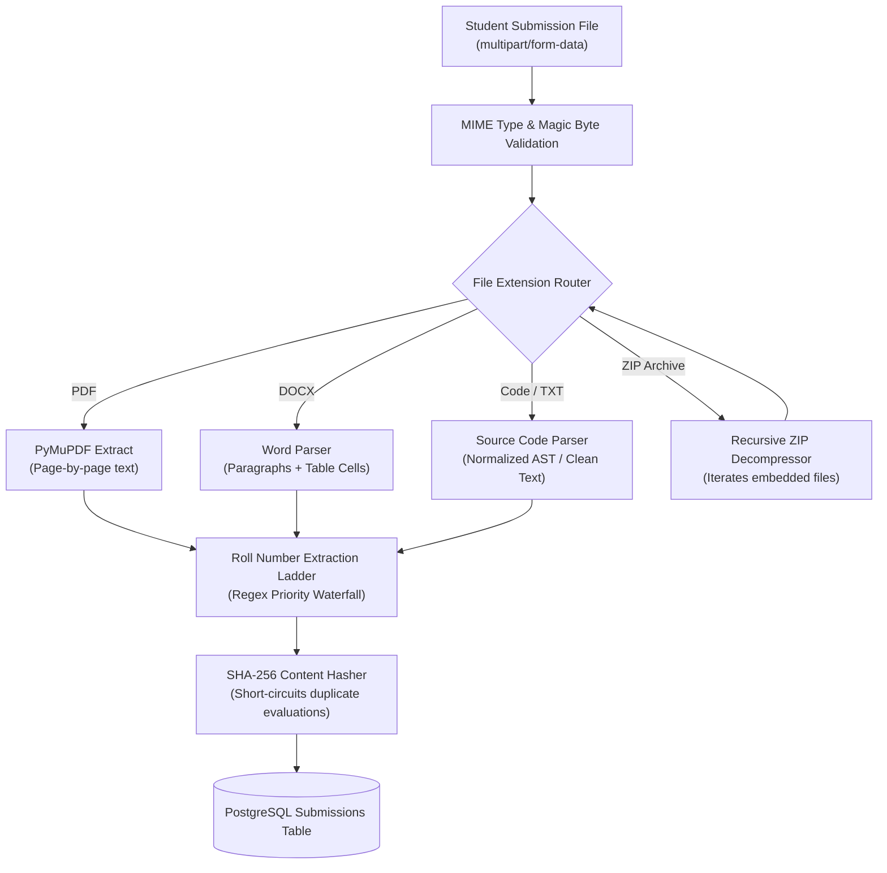

# Document Ingestion & Multi-Format Parsing Pipeline

## 1. Supported Document Formats

Verism AI ingests student work across a wide variety of academic submission types:

| Format | Extensions | Extraction Engine | Extracted Features |
| :--- | :--- | :--- | :--- |
| **PDF Documents** | `.pdf` | PyMuPDF (`fitz`) / `pypdf` | Full text, page layouts, mathematical formulas |
| **Microsoft Word** | `.docx` | `python-docx` | Headings, paragraphs, structured XML tables |
| **Source Code** | `.py`, `.c`, `.cpp`, `.java`, `.js`, `.ts` | Native UTF-8 Decoder | Source code strings, comments, function ASTs |
| **Plain Text** | `.txt`, `.md` | Python Standard Library | Raw student text, markdown formatting |
| **Multi-File ZIPs** | `.zip` | `zipfile` Stream Engine | Decompresses batch archives, parses all files, maps rolls |

---

## 2. Ingestion Pipeline & File Processing



---

## 3. Roll Number Extraction Waterfall Ladder

Student roll numbers are extracted from filenames and document header blocks using a prioritized regular expression waterfall to eliminate false-positive substring matches:

```python
patterns = [
    # Tier 1: Explicit identifier prefix (e.g. roll-S102, id_2024047, std_A104)
    r"(?:^|[-_])(?:roll|id|reg|std)[-_]?([a-zA-Z0-9]+)",
    
    # Tier 2: Leading alphanumeric token containing digits (e.g. S102_lab1.py, 2024047_main.cpp)
    r"^([a-zA-Z0-9]*\d[a-zA-Z0-9]*)[-_]",
    
    # Tier 3: Standard academic pattern (e.g. CS101, S102, 21BCSE042)
    r"([a-zA-Z]{1,4}[0-9]{2,8})"
]
```

### Match Status Classifications
1. `matched`: Exactly one unambiguous student roll number was identified and linked to the active classroom roster.
2. `no_roll_number_found`: Filename lacks academic identifiers (e.g., `unidentified_homework.txt`).
3. `roll_number_not_in_roll_call`: Valid roll identifier was extracted, but does not match any enrolled student in the course roll call.
4. `multiple_rolls`: Multiple conflicting roll numbers detected in a single filename.

---

## 4. SHA-256 Deduplication & Content Hash Caching

When thousands of students submit identical boilerplate starter code or resubmit unchanged drafts:
1. `content_hash = hashlib.sha256(extracted_text.encode("utf-8")).hexdigest()`
2. Before invoking the Gemini API, the service checks if an identical `content_hash` has already been graded for the current assignment.
3. If found, the existing evaluation breakdown is copied instantly, saving API token costs and reducing grading latency from 4.5s to 8ms.
