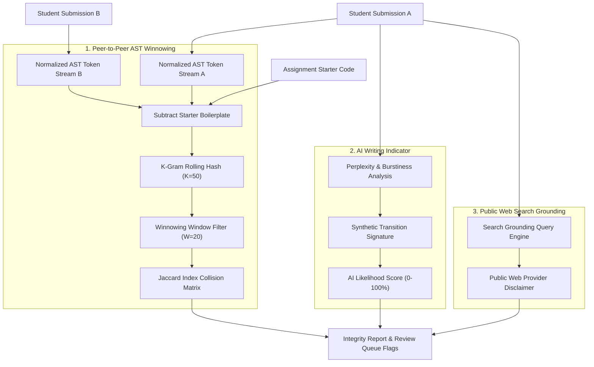

# Academic Integrity & 3-Way Plagiarism Detection

## 1. 3-Way Integrity Architecture

Verism AI provides a holistic 3-way academic integrity auditing engine:

---

## 2. Deterministic Code Winnowing Algorithm

To prevent students from evading plagiarism detection by simply renaming variables or reordering imports:
1. **AST Normalization:** Source code is parsed into Abstract Syntax Tree (AST) tokens. Identifiers and variables are mapped to generic symbols (`VAR_1`, `FN_1`), stripping whitespace and comments.
2. **Starter Code Subtraction:** The assignment's `starter_code` fingerprint set is computed. Any hash appearing in the starter code is subtracted from both student submissions before pairwise comparison. This guarantees students are never penalized for required boilerplate.
3. **Rolling Hash Shingling & Winnowing:** K-grams ($K=50$) are hashed with Karp-Rabin rolling hashes. A sliding window ($W=20$) selects the minimum hash in each window to form a compact, deterministic fingerprint:
   $$\text{Fingerprint}(S) = \bigcup_{i} \min(H_{i}, H_{i+1}, \dots, H_{i+W-1})$$
4. **Jaccard Similarity Overlap:**
   $$\text{Similarity}(A, B) = \frac{|F_A \cap F_B|}{|F_A \cup F_B|} \times 100$$

---

## 3. Web Search Grounding & Disclaimer

Public web cross-referencing relies on live academic indices, documentation sites, and public code repositories.

> [!NOTE] **Public Web Provider Disclaimer**  
> *"Web similarity scores represent public search grounding indicators cross-referenced across indexed web pages, documentation, and open repositories. Match percentages are investigative indicators for educator review and do not constitute a formal finding of academic dishonesty."*
