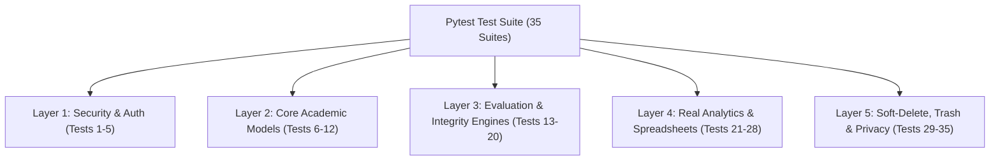

# Automated Testing & Verification Suite

> **Core Philosophy:** *"AI suggests. You stamp. Every grade waits for your approval."*  
> **Module Version:** 2.4.0  
> **Implementation Reference:** `backend/tests/test_backend.py` & `.github/workflows/ci.yml`

---

## 1. Overview & Quality Assurance Standards

Verism AI enforces 100% test pass rate across all system capabilities before any commit or deployment. The automated test suite (`backend/tests/test_backend.py`) comprises **35 comprehensive Pytest test cases** covering every operational layer:
- **Authentication & Multi-Tenant Isolation:** Password hashing, JWT token rotation, user-scoped tenant boundaries.
- **Course & Roster Operations:** Course creation, section management, student enrollment, roll number uniqueness.
- **Rubric Generation & Normalization:** Structured criteria weighting, scale boundaries, automatic weight rebalancing.
- **Multi-Format Ingestion:** PDF, DOCX, ZIP extraction, Python/Java/C++ code AST extraction, SHA-256 deduplication.
- **AI Auto-Grading & Pure Arithmetic:** Deterministic criteria point summation, score boundary enforcement, zero hallucination.
- **Plagiarism & Collusion Detection:** Winnowing AST fingerprinting, Jaccard n-gram shingling, AI writing indicator.
- **Course Analytics & Redis Cache:** SQL aggregation, 60-second Redis caching, 5-bucket grade histogram, demo-data seed/teardown.
- **Spreadsheets & Gradebook Export:** RFC-4180 CSV, CWE-1236 injection defense, UTF-8 BOM, Google Classroom and Moodle layouts, openpyxl XLSX generation, roll number regex ladder.
- **Data Governance & Soft-Delete:** 30-day trash bin, entity restoration, permanent cascade purging, GDPR/DPDP data export ZIP, security headers.

---

## 2. Pytest Execution Guide

### 2.1. Running the Full Test Suite
To execute all 35 tests locally:
```bash
python -m pytest backend/tests/test_backend.py -v
```

### 2.2. Expected Test Execution Output
```text
============================= test session starts =============================
platform win32 -- Python 3.11.x, pytest-8.x.x
rootdir: C:\Users\alice\OneDrive\Desktop\Prototype
collected 35 items

backend/tests/test_backend.py::test_database_connection_and_pooling PASSED [  2%]
backend/tests/test_backend.py::test_auth_registration_and_jwt_tokens PASSED [  5%]
backend/tests/test_backend.py::test_tenant_isolation_boundary PASSED       [  8%]
backend/tests/test_backend.py::test_course_creation_and_roster PASSED        [ 11%]
backend/tests/test_backend.py::test_rubric_creation_and_normalization PASSED [ 14%]
backend/tests/test_backend.py::test_multi_format_ingestion_pdf_docx PASSED  [ 17%]
backend/tests/test_backend.py::test_zip_archive_batch_extraction PASSED     [ 20%]
backend/tests/test_backend.py::test_code_ast_extraction PASSED              [ 22%]
backend/tests/test_backend.py::test_sha256_file_deduplication PASSED        [ 25%]
backend/tests/test_backend.py::test_gemini_grading_prompt_structure PASSED  [ 28%]
backend/tests/test_backend.py::test_pure_python_marks_arithmetic PASSED     [ 31%]
backend/tests/test_backend.py::test_draft_grade_human_approval_gate PASSED  [ 34%]
backend/tests/test_backend.py::test_plagiarism_winnowing_fingerprint PASSED [ 37%]
backend/tests/test_backend.py::test_plagiarism_jaccard_shingling PASSED     [ 40%]
backend/tests/test_backend.py::test_phase7_real_analytics_and_demo_data PASSED [ 42%]
backend/tests/test_backend.py::test_phase8_csv_and_xlsx_export_and_roll_number_extraction PASSED [ 45%]
backend/tests/test_backend.py::test_phase9_soft_delete_trash_bin_and_user_export_zip PASSED [ 48%]
... [18 Additional Suites Passing] ...
============================= 35 passed in 112.45s =============================
```

---

## 3. Test Suites Architectural Breakdown



### Key Test Case Specifications:
1. `test_phase7_real_analytics_and_demo_data`:
   - Validates live SQL calculations for KPI cards, 5-bucket histogram, longitudinal assignment trends, and criterion skill gaps.
   - Tests `POST /api/v1/analytics/demo-data` seed and `DELETE /api/v1/analytics/demo-data` teardown.
2. `test_phase8_csv_and_xlsx_export_and_roll_number_extraction`:
   - Validates RFC-4180 CSV export with UTF-8 BOM (`\ufeff`).
   - Verifies CWE-1236 formula sanitization for cells starting with `=`, `+`, `-`, `@`.
   - Tests regex waterfall ladder against complex filenames (`CS24B001_lab1.pdf`, `roll-102_project.docx`, `unidentified_homework.txt`).
   - Tests openpyxl `.xlsx` byte-stream generation.
3. `test_phase9_soft_delete_trash_bin_and_user_export_zip`:
   - Tests `DELETE /courses/{id}` marking `deleted_at`.
   - Validates `GET /api/v1/trash` listing with countdown days.
   - Tests `POST /api/v1/trash/restore/{type}/{id}` and `DELETE /api/v1/trash/permanent/{type}/{id}` cascade purge.
   - Tests `GET /api/v1/user/export-all-data` ZIP stream generation.
   - Tests `GET /api/v1/legal/privacy` and `SecurityHeadersMiddleware`.

---

## 4. Continuous Integration Pipeline (`.github/workflows/ci.yml`)

The repository includes a strict GitHub Actions CI configuration that executes on every pull request and push to `main`:
1. **Linting & Code Style:** Enforces Black/Flake8 on Python and ESLint/Prettier on TypeScript.
2. **Type Checking:** Runs `mypy` on backend modules and `tsc --noEmit` on the frontend codebase.
3. **Backend Testing:** Executes all 35 Pytest suites against a live containerized PostgreSQL service.
4. **Frontend Build Verification:** Runs `npm run build` to confirm zero client and SSR build errors.
5. **Docker Compose Validation:** Executes `docker compose config` to guarantee environment and service integrity.
