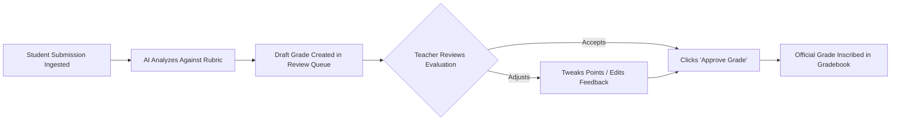

# Verism AI — Educator User Manual & Workflow Guide

> **Core Philosophy:** *"AI suggests. You stamp. Every grade waits for your approval."*  
> **Target Audience:** Professors, Teachers, Teaching Assistants, and Academic Department Heads

---

## 1. Getting Started & Dashboard Overview

Welcome to **Verism AI**, your intelligent teaching assistant designed to dramatically reduce the time spent grading essays, assignments, and programming projects without sacrificing pedagogical rigor or human judgment.

### Signing In
1. Navigate to the Verism AI portal in your web browser.
2. Sign in using your university email and institutional password.
3. Upon logging in, you will be directed to the **Course Analytics Dashboard**.

### Understanding the Course Analytics Dashboard
The dashboard provides a real-time overview of class performance for the currently active course and section selected in the top navigation bar:
- **Total Submissions:** Total number of student papers received.
- **Average Grade:** Current class-wide average score across approved assignments.
- **Approval Rate:** The percentage of assignments you have personally reviewed and stamped.
- **Flagged for Review:** Submissions requiring your attention due to potential plagiarism or low confidence scores.
- **Grade Distribution Histogram:** Visualizes student performance across 5 standard tiers (`<60%`, `60-69%`, `70-79%`, `80-89%`, `90-100%`).
- **Skill Gaps Heatmap:** Highlights specific rubric criteria where students struggled (highlighted in warm clay if below 70%).

---

## 2. Setting Up Courses & Enrolling Students

### 2.1. Creating a New Course
1. Click **My Courses** in the left navigation sidebar.
2. Click the **+ New Course** button in the top right corner.
3. Enter the Course Title (e.g., `CS201 • Distributed Systems`), Course Code (`CS201`), Term (`Fall 2026`), and create your Sections (e.g., `Section A`, `Section B`).
4. Click **Create Course**.

### 2.2. Enrolling Students & Uploading Rosters
1. Navigate to the **Roster & Roll Call** tab within your course.
2. You can add students individually by clicking **Add Student** and entering their Name, Email, and Roll Number / Student ID.
3. **Bulk CSV Import:** To enroll an entire class at once, click **Upload Roster CSV**. Select a CSV file with columns: `Name, Email, Roll Number`. Verism AI will instantly parse and enroll your students.

---

## 3. Creating Assignments & Rubrics

### 3.1. Creating an Assignment
1. Click **Assignments** in the sidebar.
2. Click **+ Create Assignment**.
3. Fill in the Assignment Title, Due Date, Maximum Points (e.g., 100), and paste your Assignment Prompt or Guidelines.
4. *(Optional)* Upload a **Reference Solution** or Model Answer. Verism AI uses this benchmark to calibrate evaluation consistency across all submissions.

### 3.2. Designing Weighted Rubrics
Verism AI evaluates student work using rubric criteria that you define:
1. Under the **Rubric Designer** section, add criteria such as *Clarity of Argument*, *Theoretical Accuracy*, *Evidence & Citations*, or *Code Formatting*.
2. Assign a point weight to each criterion (e.g., 25 points each for 4 criteria).
3. Specify performance levels (*Exemplary*, *Proficient*, *Developing*, *Unacceptable*) with guidance notes for each tier.
4. Click **Save Assignment & Rubric**.

---

## 4. Batch Submitting Student Work

Verism AI supports flexible submission ingestion:
- **Individual Files:** Drag-and-drop individual PDF, Microsoft Word (.docx), or plain text files.
- **Programming Assignments:** Upload code files in Python (`.py`), Java (`.java`), C/C++ (`.c`, `.cpp`), or JavaScript/TypeScript.
- **Bulk ZIP Upload:** Upload a single `.zip` file containing dozens or hundreds of student submissions. Verism AI unpacks the archive, performs OCR on scanned pages, extracts text, and automatically matches submissions to enrolled students using our smart roll-number matching engine.

---

## 5. The Review Queue: "AI Suggests. You Stamp."

The core workflow of Verism AI centers on human teacher oversight: **No AI-generated grade is ever released to a student without your authorization.**

### Reviewing an Individual Submission
1. Click **Review Queue** in the left sidebar.
2. Click on any submission marked `Pending Review`.
3. The evaluation workspace presents:
   - **Student Work:** Full extracted text and original document view on the left.
   - **Rubric Breakdown:** Criterion-by-criterion scores suggested by the AI on the right, accompanied by exact quotations from the student's text justifying the score.
   - **Written Feedback:** Constructive feedback detailing what the student did well and specific suggestions for improvement.
4. **Making Adjustments:** You can override any point score or edit the written feedback simply by clicking on it.
5. **Approving the Grade:** When satisfied, click the green **Approve Grade** button. The grade is stamped and finalized.

### High-Confidence Auto-Approval
For large cohorts, you can enable the **Auto-Approve High Confidence** toggle:
- Automatically approves submissions where the AI has $>90\%$ confidence and zero plagiarism flags.
- You can still inspect and edit any approved grade at any time in the Gradebook.

---

## 6. Academic Integrity & Plagiarism Review

Verism AI actively protects academic integrity:
- **Internal Cross-Submission Collusion:** Compares every submission against all other submissions in the class using AST (Abstract Syntax Tree) fingerprinting and winnowing.
- **Similarity Percentage:** Displays a collision percentage badge on each submission.
- **Side-by-Side Comparison:** Clicking on a flagged submission opens a side-by-side comparison highlighting matching phrases and structurally identical code blocks.

---

## 7. Exporting the Gradebook & LMS Integration

Once grading is complete, you can export the results into your institutional workflow:
1. Navigate to **Gradebook** in the sidebar.
2. Click the **Export Gradebook** dropdown in the top right.
3. Choose your preferred format:
   - **Final Approved CSV:** Comprehensive spreadsheet of approved marks.
   - **Google Classroom CSV:** Formatted specifically for direct upload into Google Classroom.
   - **Moodle Offline Worksheet:** Formatted for Moodle offline grading sheet upload.
   - **Excel Workbook (.xlsx):** Professionally styled Excel document with color-coded headers and auto-adjusted columns.

---

## 8. 30-Day Trash Bin & Data Recovery

Accidentally deleted a course or assignment?
1. Click **Settings** in the left sidebar.
2. Click **Open 30-Day Trash Bin**.
3. Locate the deleted item and click **Restore**. The entity and all associated submissions and grades are immediately restored.
4. Items remain in the Trash Bin for 30 days before being permanently purged.

---

## 9. Frequently Asked Questions (FAQ)

**Q: Can students see AI suggestions before I approve them?**  
*A:* No. Students never have access to draft AI suggestions. Grades only become visible or exportable after you click "Approve Grade".

**Q: What happens if a student submits a scanned document?**  
*A:* Verism AI includes built-in OCR (Optical Character Recognition) that automatically extracts clean text from scanned images and handwritten pages.

**Q: Is student personal data kept secure?**  
*A:* Yes. All student records are encrypted at rest using AES-256 encryption in compliance with FERPA and GDPR standards. Student identifiers are pseudonymized before being sent to the AI evaluation engine.
