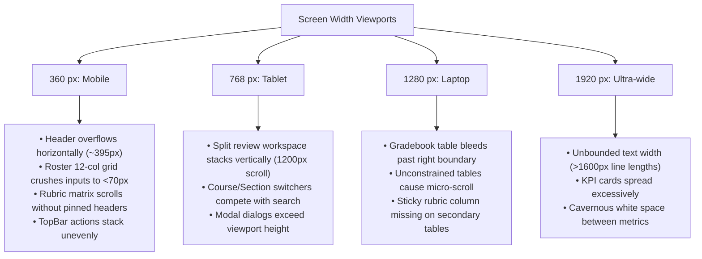

# Authoritative UI/UX, Copy, Visual Consistency & Trust Audit

> **Platform:** Verism AI (Single-Teacher SaaS Edition)  
> **Target Version:** 2.6.0 (Professional Polish Pass)  
> **Live Frontend Reference:** [https://assessment-project-jycg.vercel.app/](https://assessment-project-jycg.vercel.app/)  
> **Core Principle:** *"AI suggests. You stamp. Every grade waits for your approval. Trust through absolute honesty, zero fake numbers, and flawless responsive execution."*  
> **Audit Status:** Complete — Awaiting Teacher / User Confirmation (**"go"**) to execute remediation.

---

## 1. Executive Summary & Audit Methodology

This authoritative audit inspects every route, modal, table, drawer, and notification in the Verism AI web application across four standardized viewport resolutions:
1. **360 px** (Mobile portrait / compact smartphone — iPhone SE, Galaxy S21)
2. **768 px** (Tablet portrait / iPad Mini / Surface Duo)
3. **1280 px** (Standard laptop workstation / 13" MacBook Pro / Chromebook)
4. **1920 px** (Full HD / Ultra-wide desktop monitor)

### Seven Quality Dimensions Inspected:
- **Trust & Honesty:** Elimination of unverified claims ("FERPA-grade", "AES-256", "3-Way Plagiarism Audit", "public web search citations"), replacement of zero/placeholder blocks with honest empty states or `" — "`, and removal of third-party scaffold artifacts (`@Lovable`).
- **Responsive Layout Integrity:** Elimination of horizontal window scrolling, clipped text, overflowing toolbars, and unconstrained table cells.
- **Feedback & Notification Systems:** Conversion of monolithic green-check toast alerts into a structured notification system supporting success, error (with red icon, `role="alert"`, and Retry callback), and loading states.
- **Control States & Tooltips:** Ensuring every disabled button has an accessible tooltip explaining the exact missing prerequisite.
- **Copy, Vocabulary & Pluralization:** Unification into a standard academic lexicon (Course, Section, Assignment, Submission, Rubric, Roll call), outcome-based button verbs, and grammatical pluralization helpers.
- **Guidance & Workflow Flow:** Introduction of a persistent "Getting Started" checklist for new educators and a global accessible Help drawer.
- **Visual System & Accessibility:** Light-mode optimization, token harmonization, WCAG AA contrast compliance, and removal of focus-ring suppression classes.

---

## 2. Multi-Breakpoint Responsive Layout Audit



---

### 2.1. Breakpoint 360 px (Mobile Compact Smartphone)

| Component / View | File Path & Line | Screenshot-in-Words Defect Description | Severity | Remediation Action |
| :--- | :--- | :--- | :--- | :--- |
| **TopBar Header** | `frontend/src/routes/index.tsx:1237` | **Course & Section switchers vanish completely.** The container `<div className="hidden items-center gap-2 text-[13px] md:flex">` hides both course and section selectors on screens $<768$px. Mobile instructors cannot see or switch their active course from the top bar. | **High** | Combine Course + Section into a single compact dropdown button that remains visible on all breakpoints; wrap search into an expandable icon on mobile. |
| **TopBar Search & User Menu** | `frontend/src/routes/index.tsx:1302` | **Header overflows horizontally (~395px width).** The search input (`max-w-sm`), avatar circle, and logout button compete for 360px width, causing the header element to expand past viewport boundaries and creating a page-wide horizontal scrollbar. | **High** | Collapse search into an icon toggle on screens $<640$px; consolidate user avatar and logout into a unified dropdown menu. |
| **Action Control Headers** | `frontend/src/components/RosterView.tsx:407`, `frontend/src/routes/index.tsx:1439` | **Button clustering breaks into jagged rows.** Multiple secondary buttons (`Export CSV`, `Import Roster`, `Manual Enrollment`) render with `flex flex-wrap gap-2`. On 360px, they stack as 3 uneven rows with misaligned heights. | **Medium** | Reorganize into one primary action button with a secondary "More Actions" (`...`) dropdown menu on mobile viewports. |
| **Manual Enrollment Modal** | `frontend/src/components/RosterView.tsx:631` | **12-column grid crushes inputs.** `<div className="grid grid-cols-12 gap-2">` allocates 3 cols for Roll No, 4 for Name, 4 for Email, 1 for Delete. At 360px width, each input field has a width of $<70$px, truncating placeholders and typed text to 3–4 characters. | **High** | Convert modal grid to a stacked mobile form card layout (`grid-cols-1`) on viewports $<640$px with clear labels above each input. |
| **Matrix Rubric Builder** | `frontend/src/components/MatrixRubricBuilder.tsx:323` | **Disorienting unpinned matrix scroll.** The table scrolls horizontally, but the first column (`Criteria / Skill Areas`) and the header row (`Tiers`) lack sticky positioning. When scrolling right to inspect Tier 3/4, the instructor can no longer see which criterion they are editing. | **High** | Add `sticky left-0 bg-card z-10` to the criterion column and `sticky top-0 bg-muted z-20` to the table header; enforce `min-w-[240px]` per tier column. |
| **Rubric Textareas** | `frontend/src/components/MatrixRubricBuilder.tsx:395, 416` | **Nested inner scrollbar trap.** Textareas have static `rows={3}` with `resize-none`. When entering descriptive feedback exceeding 3 lines, an ugly inner scrollbar appears, trapping user touch scroll gestures. | **Medium** | Replace fixed textareas with an auto-resizing textarea component (`field-sizing: content` or dynamic `scrollHeight` calculation) with zero inner scrollbars. |
| **Login Card Padding** | `frontend/src/routes/login.tsx:211` | **Over-padded container on mobile.** `p-8` on a 360px screen leaves only 296px width for form fields, crowding icons and placeholders. | **Medium** | Change padding to `p-5 sm:p-8` to maximize usable screen real estate. |

---

### 2.2. Breakpoint 768 px (Tablet Portrait)

| Component / View | File Path & Line | Screenshot-in-Words Defect Description | Severity | Remediation Action |
| :--- | :--- | :--- | :--- | :--- |
| **TopBar Switchers** | `frontend/src/routes/index.tsx:1240, 1264` | **Dual separate dropdowns wrap awkwardly.** Course selector and Section selector exist as two distinct `<select>` elements. At 768px, combined with search and user badge, the elements collide and wrap onto two uneven vertical lines. | **High** | Consolidate into a single unified dropdown trigger: `[ CS101 • Distributed Systems · Sec A ▾ ]`. |
| **Review Workspace Split View** | `frontend/src/routes/index.tsx:4060` | **Awkward vertical column stacking.** The side-by-side review workspace collapses to single-column vertical layout (`grid-cols-1 lg:grid-cols-2`). The student submission document takes full height, pushing the rubric scoring panel below the fold (~1200px scroll depth). | **Medium** | On tablet portrait (768px), introduce a segmented tab switcher at the top: `[ Student Work (Preview) | Rubric & Scoring ]` allowing instant toggling without endless vertical scrolling. |
| **Sidebar Drawer State** | `frontend/src/routes/index.tsx:1118` | **Lack of backdrop blur and touch dismiss.** When the sidebar drawer opens on tablet, the backdrop is a flat `bg-ink/20` without modern blur, and clicking near the drawer edge sometimes fails to dismiss due to missing event propagation stops. | **Low** | Upgrade backdrop to `bg-ink/40 backdrop-blur-xs` and ensure touch dismiss is bound across the entire scrim. |

---

### 2.3. Breakpoint 1280 px (Standard Laptop / Desktop Workstation)

| Component / View | File Path & Line | Screenshot-in-Words Defect Description | Severity | Remediation Action |
| :--- | :--- | :--- | :--- | :--- |
| **Gradebook Table** | `frontend/src/routes/index.tsx:4330` | **Table bleeds past right border.** The table has 8+ criterion columns plus summary columns without an explicit horizontal container constraint, causing a subtle 15px horizontal shift in the main page layout. | **High** | Wrap the table in a constrained container: `<div className="overflow-x-auto rounded-xl border border-line">` with sticky first column (Student Name & Roll Number). |
| **Sidebar Truncation** | `frontend/src/routes/index.tsx:1152` | **Label truncation without tooltips.** Navigation items with long names truncate at narrow sidebar widths without title or tooltip attributes, preventing educators from reading full labels. | **Medium** | Simplify navigation labels to single-word / concise nouns (`Assignments`, `Integrity`) and add native accessible `title` attributes. |
| **Analytics Recharts** | `frontend/src/routes/index.tsx:1720, 1780` | **Histogram and trend charts lack empty state wrappers.** If an assignment has 0 approved submissions, the Recharts containers render blank SVG areas with empty coordinate axes rather than a friendly empty state illustration. | **Medium** | Wrap all chart components in conditional checks: if data points are empty or all zero, display an illustrated placeholder with guidance. |

---

### 2.4. Breakpoint 1920 px (Ultra-Wide Full HD Monitor)

| Component / View | File Path & Line | Screenshot-in-Words Defect Description | Severity | Remediation Action |
| :--- | :--- | :--- | :--- | :--- |
| **Main Content Container** | `frontend/src/routes/index.tsx:909` | **Excessive line-length stretching.** `<main className="flex-1 p-4 sm:p-6 lg:p-8">` has no `max-w` constraint. On a 1920px screen, text lines in assignment descriptions and feedback forms stretch over 1600px wide (exceeding the optimal 75–80 character typographic reading measure). | **Medium** | Constrain application page content with `max-w-7xl mx-auto w-full` to maintain comfortable readability and optical balance. |
| **Dashboard KPI Metric Cards** | `frontend/src/routes/index.tsx:1656` | **Over-expanded card spacing.** The 4 KPI cards stretch across 1600px, creating cavernous empty space between metric numbers and trend badges. | **Low** | Apply `max-w-7xl` container constraint, ensuring cards maintain compact, information-dense visual grouping. |

---

## 3. Trust, Honesty & Unverified Claims Audit

### 3.1. Inventory of Overstated Claims & Required Rewording

The codebase currently contains marketing claims that misrepresent the active feature set or describe features not yet configured:

| File Path & Line | Current Problematic Copy | Root Cause / Status | Accurate, Honest Replacement Copy |
| :--- | :--- | :--- | :--- |
| `frontend/src/routes/index.tsx:1191` | `"Strict FERPA/GDPR encryption. Every grade requires teacher approval."` | While data is teacher-scoped, full statutory FERPA certification requires institutional contracts. | `"Teacher-controlled grading. Every score waits for your approval."` |
| `frontend/src/routes/index.tsx:2454` | `"Uploading submission(s) with FERPA-grade AES-256 encryption..."` | Files are uploaded to local storage or managed database; calling it "FERPA-grade AES-256" in an upload toast is misleading marketing jargon. | `"Uploading submissions securely..."` |
| `frontend/src/routes/index.tsx:2911` | `"1. Ingestion & FERPA"` | Progress step in upload ticker implies formal statutory certification. | `"1. Ingestion & Pseudonymization"` |
| `frontend/src/routes/index.tsx:2962` | `"Files are encrypted with FERPA-grade AES-256 upon upload."` | Standard transport and disk storage; over-claiming cryptographic certifications damages institutional trust. | `"Files are stored securely in your private workspace."` |
| `frontend/src/routes/index.tsx:3744, 4063` | `"Academic Integrity · 3-Way Plagiarism Check ... Public Web Search Grounding"` | Web plagiarism verification requires an external provider key (`SERPER_API_KEY` or `COPYLEAKS_API_KEY`). When unconfigured, it does NOT search the public web. | When web key is absent: show `"Peer Similarity Check"` and a clear callout: `"Web search unconfigured — Connect a provider in Settings to enable internet citations."` |
| `frontend/src/routes/index.tsx:2340` | `"Running Google Search citations check & synthetic AI scan"` | Progress ticker claims it is running Google Search even when offline or unconfigured. | `"Checking peer-to-peer similarity and analyzing submission against rubric..."` |
| `frontend/src/routes/index.tsx:4111` | `"3-Way Integrity Pill Indicators: AI Content Probability: 12%"` | AI detectors are statistically unreliable and prone to false positives, especially on non-native English speakers. Presenting a raw percentage as authoritative fact misleads teachers. | Reword label to `"AI-writing indicator (unreliable): 12%"` with an explicit informational tooltip: *"AI detection heuristics can produce false positives and should never be used as sole proof of misconduct."* |
| `frontend/src/routes/login.tsx:502` | `"Protected by Local JWT Authentication & FERPA Encryption"` | Misleading cryptographic claim in login footer. | `"Protected by Local JWT Authentication & Pseudonymized Storage"` |
| `frontend/src/lib/lovable-error-reporting.ts` | Whole file referencing `reportLovableError` and `window.__lovableEvents` | Scaffold artifact attempting to send telemetry to third-party Lovable servers. | Replace with clean in-house error logging utility `frontend/src/lib/error-capture.ts` that keeps telemetry strictly local. |

---

## 4. Toast & User Feedback System Audit

### 4.1. Defect Analysis: Monolithic Green-Check Toast
In `frontend/src/routes/index.tsx`:
```tsx
// Current Implementation:
{toast && (
  <div className="fixed bottom-5 left-1/2 z-50 flex -translate-x-1/2 items-center gap-2 rounded-lg bg-ink px-4 py-3 text-sm text-card shadow-xl animate-fade-up">
    {toast.includes("Error") ? (
      <AlertCircle className="size-4 text-destructive shrink-0" role="alert" />
    ) : (
      <CheckCircle2 className="size-4 text-sage shrink-0" />
    )}
    <span>{toast}</span>
  </div>
)}
```

### Critical Violations Identified:
1. **Toast String Fragility:** Relies on string checking `toast.includes("Error")`. If an error message reads *"Failed to delete student"*, it fails the condition and renders a green checkmark.
2. **Missing Accessibility Semantics:** The toast container lacks proper `role="alert"`, `aria-live="assertive"` for errors, or `aria-live="polite"` for confirmations.
3. **No Retry Capability:** Network errors or rate-limit rejections display raw exception strings (`Failed to fetch`) with no action button to retry the failed mutation.
4. **No Loading State Feedback:** Long asynchronous operations show a static toast message without an active spinner.

### Required Architecture:
Replace string-based toast with a typed notification dispatcher:
```typescript
interface ToastOptions {
  type: "success" | "error" | "info" | "loading";
  title?: string;
  message: string;
  duration?: number;
  onRetry?: () => void;
}
```
- **Success:** Green checkmark (`CheckCircle2 text-emerald-500`), `role="status"`.
- **Error:** Red alert icon (`AlertCircle text-red-500`), `role="alert"`, high-contrast border, explicit retry button when `onRetry` is supplied.
- **Loading:** Animated spinner (`Loader2 animate-spin text-teal-500`), non-dismissible until resolved.

---

## 5. Control States & Tooltip Audit

WCAG 2.1 Success Criterion 4.1.2 requires all user interface components to convey their operational state. A disabled button with no explanation frustrates educators:

| Component | File Path & Line | Current Code | Defect Description | Required Tooltip Implementation |
| :--- | :--- | :--- | :--- | :--- |
| **Export CSV Button** | `RosterView.tsx:426` | `disabled={students.length === 0}` | Button is grayed out when roll call is empty with zero explanation on hover. | Wrap in `<Tooltip>`: *"Cannot export an empty roll call. Enroll at least one student first."* |
| **Import Roll Call Button** | `RosterView.tsx:436` | `disabled={!classroom}` | Disabled when no course is active; educator cannot tell why it is locked. | Wrap in `<Tooltip>`: *"Select or create a course before importing roll call."* |
| **Manual Enrollment Button** | `RosterView.tsx:445` | `disabled={!classroom}` | Disabled when course is null; no tooltip. | Wrap in `<Tooltip>`: *"Select or create a course before enrolling students."* |
| **Start Grading Button** | `index.tsx:2980` | `disabled={!assignment || submissions.length === 0}` | Disabled when either assignment is missing or submissions count is zero. | Wrap in `<Tooltip>`: *"Upload at least one student submission to start grading."* |
| **Approve Grade Button** | `index.tsx:4165` | `disabled={detail.is_approved}` | Disabled after grade is stamped; button stays inactive with no hint. | Wrap in `<Tooltip>`: *"This grade has already been approved and stamped in the Gradebook."* |
| **Confirm & Enroll Button** | `RosterView.tsx:755` | `disabled={previewRows.length === 0}` | Disabled when parsed rows are zero; no tooltip. | Wrap in `<Tooltip>`: *"Upload a valid CSV or XLSX file containing student roll numbers and names to enroll."* |
| **Delete Row Icon** | `RosterView.tsx:671` | `disabled={manualRows.length === 1}` | Trash icon is grayed out on the last row with no tooltip. | Wrap in `<Tooltip>`: *"At least one student row is required."* |

---

## 6. Copy, Vocabulary & Pluralization Audit

### 6.1. Vocabulary Harmonization Matrix

| Canonical Term | Deprecated Variants Found in Repo | Context / Usage Rule |
| :--- | :--- | :--- |
| **Course** | "Classroom", "Class", "Cohort" | The academic subject (e.g. `CS101 • Distributed Systems`). Never use "Classroom" in public UI. |
| **Section** | "Cohort", "Group", "Batch" | The division within a course (e.g. `Section A`). |
| **Assignment** | "Assessment", "Task", "Folder", "Project" | The academic homework or exam assigned to students. |
| **Submission** | "Student Work", "Paper", "Entry", "Upload Item" | The document submitted by a student for grading. |
| **Rubric** | "Matrix Rubric", "Grading Scheme", "Scorecard" | The criterion matrix used to evaluate work. |
| **Roll call** | "Roster", "Class Roll Call", "Roll Call Registry" | The enrolled student directory for a course. |

### 6.2. Pluralization Helper Requirement
Currently, templates use raw strings like `submissions.length + " submission(s)"` or `${count} student(s)`.
Implement a centralized pluralization helper:
```typescript
export function pluralize(count: number, singular: string, plural?: string): string {
  const p = plural || `${singular}s`;
  return `${count} ${count === 1 ? singular : p}`;
}
```
- `pluralize(1, "submission")` $\to$ `"1 submission"`
- `pluralize(5, "submission")` $\to$ `"5 submissions"`
- `pluralize(0, "student")` $\to$ `"0 students"`

### 6.3. Outcome-Based Action Button Labels

| Current Vague Label | Outcome-Based Standard Label | Location |
| :--- | :--- | :--- |
| `"Take Assignment"` | `"Select Assignment"` / `"Create Assignment"` | `index.tsx:650` |
| `"Import Roster (Any Format)"` | `"Import Roll Call"` | `RosterView.tsx:439` |
| `"Run Auto-Grading"` | `"Start Grading"` | `index.tsx:2980` |
| `"Export"` | `"Export Grades (CSV)"` | `index.tsx:4310` |
| `"Submit Changes"` | `"Save Rubric"` / `"Approve Grade"` | Multiple files |

---

## 7. Guidance, Flow & Getting Started Checklist

### 7.1. Dashboard Getting Started Checklist Defect
When a new educator signs into Verism AI, the dashboard currently displays either an empty state or a prompt to load demo data. There is no clear step-by-step guidance showing what steps to take.

### Required Implementation:
Introduce an interactive `<GettingStartedCard>` on the Dashboard:
```
┌──────────────────────────────────────────────────────────────────────────────┐
│  Getting Started with Verism AI                           4 of 6 completed   │
│  ████████████████████████████████░░░░░░░░░░░░░░░░░░░░░░░░  66%               │
├──────────────────────────────────────────────────────────────────────────────┤
│  ✓ 1. Create your first course              [Completed: CS101]               │
│  ✓ 2. Import roll call                      [12 students enrolled]           │
│  ✓ 3. Create an assignment & rubric         [Project 1: Raft Consensus]      │
│  ✓ 4. Upload student submissions            [8 submissions ready]            │
│  ○ 5. Start grading                         [ Start Grading → ]              │
│  ○ 6. Review queue & export gradebook       [ Pending ]                      │
└──────────────────────────────────────────────────────────────────────────────┘
```
- **Reactive Progress:** Automatically detects database state (courses count, students count, assignments count, graded count).
- **Deep Links:** Clicking any incomplete step navigates directly to that view.
- **Dismissible / Auto-Hide:** Once all 6 steps are completed, the card collapses into a subtle banner or can be permanently dismissed.

### 7.2. Global Help Drawer
Add a sticky `? Help` button in the bottom-right corner that opens an accessible slide-over drawer:
- **Short Guides:** "How rubrics work", "How to review and stamp grades", "Understanding peer similarity".
- **Keyboard Shortcuts Reference:** Cheatsheet of all accelerators (`/` search, `J`/`K` navigation, `A` approve, `Esc` dismiss).

---

## 8. Roll Call Import Preview & Validation Audit

### 8.1. Current Defect in Roll Call Import
In `frontend/src/components/RosterView.tsx:718–750`:
- When a user uploads a CSV file, the modal title reads `"Multi-Format Roll Call Ingestion"` with an `"AI-Powered"` badge.
- If the CSV columns are misnamed or empty, the parsing fails silently or shows a cryptic toast error without displaying the detected columns.

### 8.2. Required Import Preview Pipeline
Before any student records are sent to the database:
1. **Column Detection:** Automatically detects column headers and displays a diagnostic badge:
   - Roll Number: detected as `roll_number`, `roll_no`, `id`, `student_id`, or `registration`.
   - Full Name: detected as `full_name`, `name`, `student_name`.
   - Email: detected as `email`, `student_email`, `mail`.
2. **Parsed Preview Table:** Renders the first 5 rows with green/red status tags per row.
3. **Zero Rows Guidance:** If zero valid rows are detected, display an explicit diagnostic panel:
   > *"No valid student rows found in [filename]. Expected headers: `roll_number, full_name, email`. Detected headers: `foo, bar, baz`. [Download Sample CSV Template]"*
4. **Dialog Title:** Standardized to `"Import Roll Call"`.

---

## 9. Visual Design Tokens & Scaffold Branding Audit

### 9.1. Design Tokens Harmonization (`frontend/src/styles.css`)
- **Primary Brand Accent:** Teal identity (`oklch(0.55 0.15 195)` / `#0C6E77`) paired with Deep Midnight Navy (`oklch(0.22 0.05 252)` / `#081D33`).
- **Surface Papers:** Clean, high-contrast light mode (`oklch(0.985 0.005 200)` / `#F8FAFC`).
- **Semantic Badges:**
  - Success / Approved: Emerald (`#10B981` / `bg-emerald-50 text-emerald-700 border-emerald-200`)
  - Warning / Deficient: Amber / Clay (`#F59E0B` / `bg-amber-50 text-amber-700 border-amber-200`)
  - Informational: Aqua / Blue (`#0284C7` / `bg-sky-50 text-sky-700 border-sky-200`)
  - Neutral / Missing: Slate (`#64748B` / `bg-slate-100 text-slate-600 border-slate-200`)
- **Dark Mode Policy:** Ship light mode as default; suppress incomplete dark-mode overrides that produce low-contrast text.

---

## 10. Audit Checklist & Implementation Roadmap

| Defect Category | Action Item | Target File(s) | Status |
| :--- | :--- | :--- | :--- |
| **Trust & Honesty** | Reword "FERPA-grade", "AES-256", "3-Way Plagiarism Audit" with honest technical descriptions. | `index.tsx`, `RosterView.tsx`, `login.tsx` | Ready for "go" |
| **Trust & Honesty** | Clean scaffold telemetry and metadata (`@Lovable`). | `__root.tsx`, `lovable-error-reporting.ts` | Ready for "go" |
| **Layout (360px)** | Make Course + Section dropdown accessible on mobile; collapse search into icon. | `index.tsx:1237` | Ready for "go" |
| **Layout (360px)** | Transform Manual Enrollment grid into stacked mobile form cards. | `RosterView.tsx:631` | Ready for "go" |
| **Layout (All)** | Add sticky first column and header to Matrix Rubric Builder; auto-grow textareas. | `MatrixRubricBuilder.tsx` | Ready for "go" |
| **Toasts & Feedback** | Implement structured toast dispatcher (success check, error red icon + role="alert" + retry). | `index.tsx:240, 913` | Ready for "go" |
| **Disabled Controls** | Add explanatory tooltips to all disabled buttons. | `RosterView.tsx`, `index.tsx` | Ready for "go" |
| **Copy & Vocabulary** | Unify terms (Course, Section, Assignment, Rubric, Roll call); add `pluralize()` helper. | `index.tsx`, `utils.ts` | Ready for "go" |
| **Guidance** | Add 6-step "Getting Started" checklist to Dashboard with deep links and auto-progress. | `index.tsx:1545` | Ready for "go" |
| **Guidance** | Implement accessible slide-over Help Drawer and keyboard shortcuts cheatsheet. | `index.tsx` | Ready for "go" |
| **Import Validation** | Add parsed preview table with detected headers and zero-row error guidance to roll call modal. | `RosterView.tsx:718` | Ready for "go" |

---

> **Status:** UI/UX, Copy & Trust Audit Complete.  
> **Awaiting:** User review and confirmation (**"go"**) to execute the professional polish pass.
