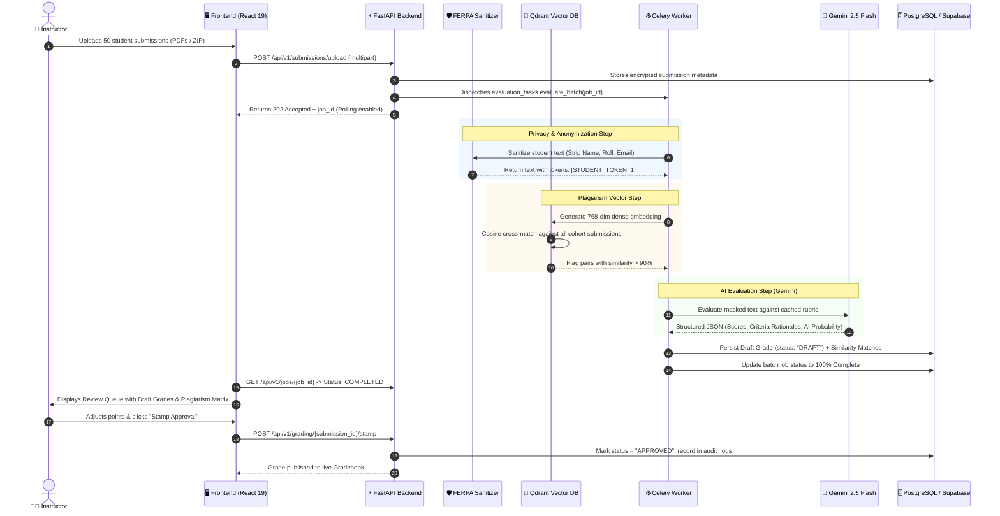

# 🏛️ 02. System Architecture & Data Flow

> 📌 **Parent Page:** [00. Notion Workspace Hub](file:///c:/Users/alice/OneDrive/Desktop/Prototype/notion_docs/00_NOTION_WORKSPACE_HUB.md)  
> 🏷️ **Status:** 🟢 Active  
> 📅 **Last Updated:** 2026-10-29  

---

## 🏗️ High-Level Architectural Topology

Verism AI is engineered as a decoupled modern web application with high-throughput asynchronous processing:

```
┌────────────────────────────────────────────────────────────────────────┐
│                        CLIENT LAYER (Browser)                         │
│                                                                        │
│   TanStack Start / React 19 Frontend  (Vite + Tailwind CSS + Lucide)   │
│   - Real-time Dashboard           - Matrix Rubric Builder             │
│   - Submission Dropzone (PDF/ZIP) - Plagiarism Diff Inspector         │
│   - Review & Grade Stamping Queue - Live Gradebook Spreadsheet        │
└───────────────────────────────────┬────────────────────────────────────┘
                                    │
                        HTTPS / JSON REST API (CORS)
                                    │
                                    ▼
┌────────────────────────────────────────────────────────────────────────┐
│                     BACKEND APPLICATION CORE (FastAPI)                 │
│                                                                        │
│  ├── /api/v1/ Routers (Auth, Courses, Assignments, Grading, etc.)      │
│  ├── Core Middleware (CORS, JWT Bearer Auth, Request Auditing)         │
│  ├── Security & Privacy Layer (Fernet AES-128 Encryption & Redaction)  │
│  └── SQLAlchemy 2.0 ORM & Supabase Client Integration                  │
└──────────────┬──────────────────────────────┬──────────────────────────┘
               │                              │
      Synchronous Reads / Writes      Dispatches Async Jobs
               │                              │
               ▼                              ▼
┌─────────────────────────────┐ ┌────────────────────────────────────────┐
│      PERSISTENCE LAYER      │ │            ASYNC WORKER LAYER          │
│                             │ │                                        │
│  PostgreSQL / Supabase DB   │ │   Celery Worker Pool + Redis Broker    │
│  (Instructors, Classrooms,  │ │   - Batch File Extraction (ZIP/PDF)    │
│   Students, Submissions,    │ │   - Vector Generation & Indexing       │
│   Draft Grades, Audit Logs) │ │   - High-throughput Gemini Evaluation  │
└──────────────┬──────────────┘ └──────────────┬─────────────────────────┘
               │                               │
               │                               ▼
               │                ┌────────────────────────────────────────┐
               │                │          AI & VECTOR SERVICES          │
               │                │                                        │
               │                │  1. Qdrant Vector Engine:              │
               │                │     - 768-dim semantic embeddings      │
               │                │     - Sub-cohort cosine similarity     │
               │                │                                        │
               │                │  2. Google GenAI (Gemini 2.5 Flash):   │
               │                │     - Rubric Context Caching (2h TTL)  │
               │                │     - Structured Pydantic JSON Output  │
               │                │     - Multimodal PDF Token Inspection  │
               │                └────────────────────────────────────────┘
```

---

## 🔄 End-to-End Submission Pipeline (Sequence Flow)



---

## 🧩 Component Responsibilities Matrix

| Subsystem | Technology | Responsibility | Failure Mode / Fallback |
| :--- | :--- | :--- | :--- |
| **Frontend UI** | React 19, TanStack Start, Tailwind | Teacher control panel, drag-and-drop batch upload, side-by-side diffing, live gradebook table | Client-side optimistic updates with retry toasts on network disruption |
| **Backend API** | FastAPI, Python 3.11+ | REST routing, authentication, request validation, cryptographic encryption, permission checks | Automatic 4xx/5xx structured error JSON schemas conforming to RFC 7807 |
| **Worker Queue** | Celery + Redis | Long-running asynchronous evaluation of batches (up to 200 submissions per batch) | Falls back to FastAPI `BackgroundTasks` if Redis is unreachable in local dev |
| **Vector DB** | Qdrant | Peer-to-peer semantic similarity cross-checks within assignment cohorts | In-memory `:memory:` fallback for rapid local prototyping without Docker |
| **LLM Engine** | Google GenAI (Gemini 2.5 Flash) | Criterion scoring, rationale generation, AI text stylometry estimation | Pre-compiled structured schemas guarantee 100% parseable JSON; automatic token backoff |
| **Persistence** | PostgreSQL (Supabase) + SQLite | Relational storage for users, courses, assignments, rubrics, submissions, and audit records | Development SQLite automatic schema bootstrapping via `seed_data.py` |
