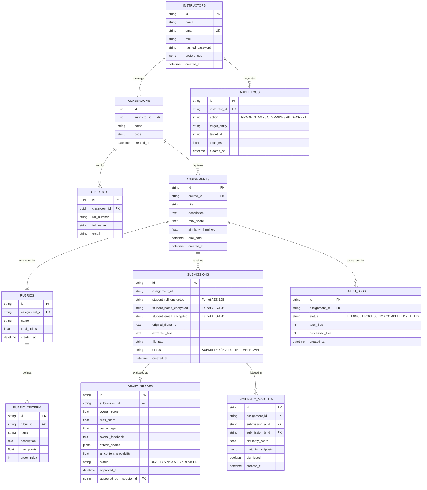

# 🗄️ 06. Database Schema & ERD

> 📌 **Parent Page:** [00. Notion Workspace Hub](file:///c:/Users/alice/OneDrive/Desktop/Prototype/notion_docs/00_NOTION_WORKSPACE_HUB.md)  
> 🏷️ **Status:** 🟢 Active  
> 📅 **Last Updated:** 2026-10-29  
> 💾 **Database Engine:** PostgreSQL 16 (Supabase) / SQLite 3.38+ for local dev  

---

## 🗺️ Entity Relationship Diagram (ERD)



---

## 📊 Core Tables Specification

### 1. `instructors`
Stores authenticated faculty members and institutional accounts.
- `id` (VARCHAR(64), Primary Key)
- `email` (VARCHAR(255), Unique, Indexed)
- `name` (VARCHAR(255), Not Null)
- `role` (VARCHAR(128), Default: `'Instructor · Computer Science'`)
- `hashed_password` (VARCHAR(255), Bcrypt hash)
- `preferences` (JSONB): Teacher UI settings, e.g. `{"show_similarity_context": true, "require_teacher_notes_on_overrides": false}`

### 2. `classrooms` & `students`
Manages course sections and enrolled student rosters.
- `classrooms.id` (UUID, Primary Key)
- `classrooms.name` (TEXT, e.g. "Data Structures & Algorithms")
- `classrooms.code` (TEXT, e.g. "CS201")
- `students.id` (UUID, Primary Key)
- `students.classroom_id` (UUID, FK -> `classrooms.id` ON DELETE CASCADE)
- `students.roll_number` (TEXT, Unique per classroom)
- `students.full_name` (TEXT)
- `students.email` (TEXT)

### 3. `submissions` (FERPA Compliant Encrypted Storage)
Stores assignment turn-ins while keeping student PII cryptographically protected.
- `id` (VARCHAR(64), Primary Key)
- `assignment_id` (VARCHAR(64), FK -> `assignments.id`)
- `student_name_encrypted` (VARCHAR(512), AES-128-CBC Fernet)
- `student_roll_encrypted` (VARCHAR(512), AES-128-CBC Fernet)
- `student_email_encrypted` (VARCHAR(512), AES-128-CBC Fernet)
- `extracted_text` (TEXT, Clean plain text extracted from PDF/DOCX)
- `file_path` (VARCHAR(512), Local or S3/Supabase storage URI)
- `status` (VARCHAR(32), Default: `'SUBMITTED'`)

### 4. `draft_grades`
Stores AI-suggested marks before and after human teacher review.
- `id` (VARCHAR(64), Primary Key)
- `submission_id` (VARCHAR(64), FK -> `submissions.id`, Unique)
- `overall_score` (FLOAT, Calculated total points)
- `max_score` (FLOAT, Denominator points)
- `percentage` (FLOAT, Score %)
- `overall_feedback` (TEXT, Summary feedback for the student)
- `criteria_scores` (JSONB, Breakdown array matching rubric criteria)
- `ai_content_probability` (FLOAT, 0–100% synthetic stylometry marker)
- `status` (VARCHAR(32), `'DRAFT'` until teacher clicks "Stamp Approval", then `'APPROVED'`)
- `approved_at` (TIMESTAMPTZ)
- `approved_by` (VARCHAR(64), FK -> `instructors.id`)

### 5. `similarity_matches`
Stores cross-submission pair comparisons exceeding the assignment's threshold.
- `id` (VARCHAR(64), Primary Key)
- `assignment_id` (VARCHAR(64), FK -> `assignments.id`)
- `submission_a_id` (VARCHAR(64), FK -> `submissions.id`)
- `submission_b_id` (VARCHAR(64), FK -> `submissions.id`)
- `similarity_score` (FLOAT, Cosine similarity score 0.00–1.00)
- `matching_snippets` (JSONB, Array of overlapping verbatim string spans)
- `dismissed` (BOOLEAN, Default: `false`)

---

## ⚡ Indexing Strategy

To guarantee rapid queries during peak grading periods:
```sql
CREATE INDEX idx_classrooms_instructor ON public.classrooms(instructor_id);
CREATE INDEX idx_students_classroom ON public.students(classroom_id);
CREATE INDEX idx_students_roll ON public.students(classroom_id, roll_number);
CREATE INDEX idx_submissions_assignment ON public.submissions(assignment_id);
CREATE INDEX idx_draft_grades_submission ON public.draft_grades(submission_id);
CREATE INDEX idx_draft_grades_status ON public.draft_grades(status);
CREATE INDEX idx_similarity_assignment ON public.similarity_matches(assignment_id);
CREATE INDEX idx_similarity_score ON public.similarity_matches(similarity_score DESC);
CREATE INDEX idx_audit_instructor ON public.audit_logs(instructor_id);
```
